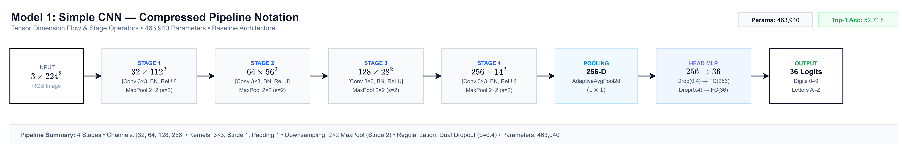
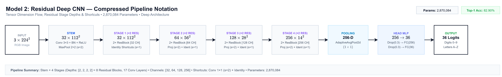
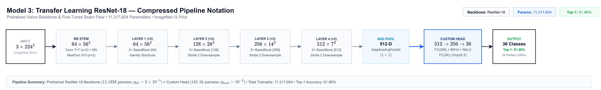
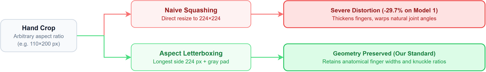
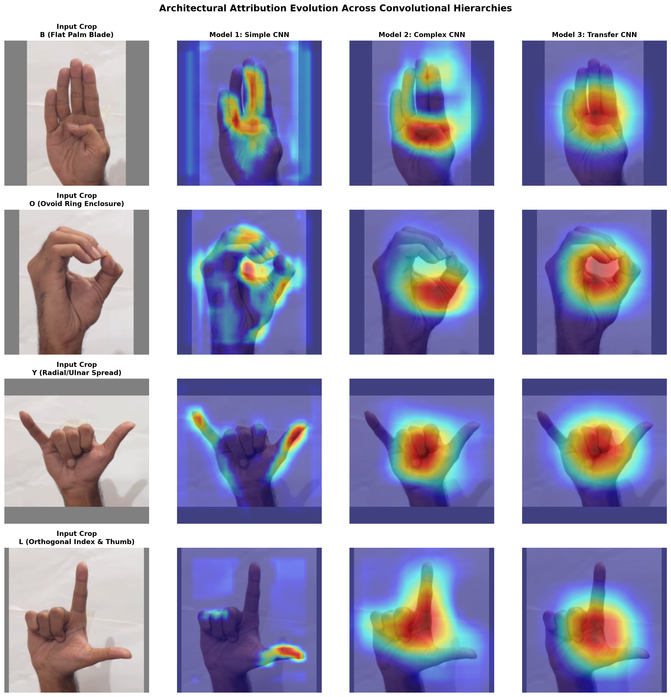
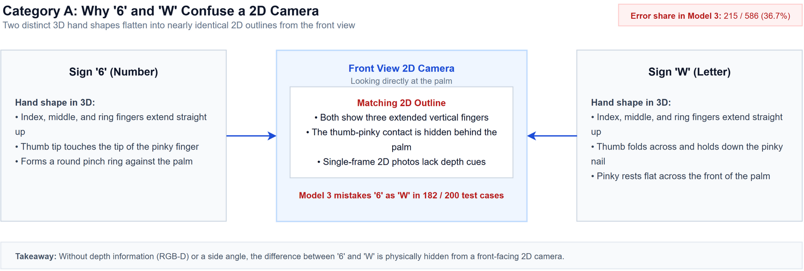
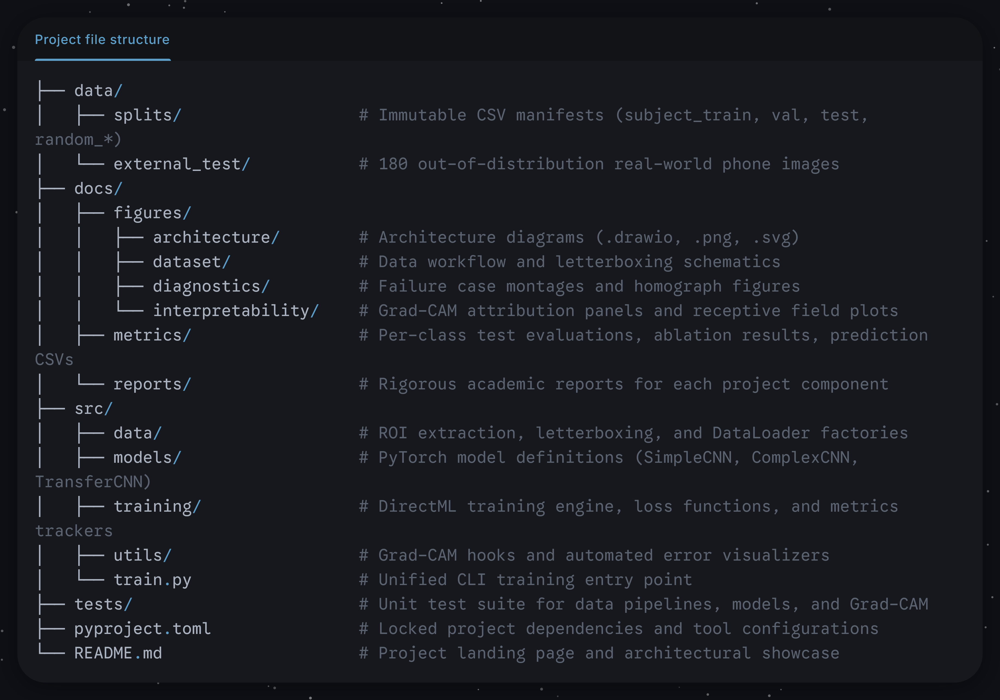

<div align="center">

# Real-Time American Sign Language (ASL) Fingerspelling Recognition

[](https://www.python.org/)
[](https://pytorch.org/)
[](https://github.com/microsoft/DirectML)
[](tests/)
[](docs/reports/project_overview.md)

An end-to-end deep learning framework for single-frame ASL fingerspelling recognition across 36 alphanumeric classes (digits `0`–`9`, letters `A`–`Z`), evaluated on the 36,000-image [ASL-HG benchmark](https://data.mendeley.com/datasets/j4y5w2c8w9/1) under strict subject-independent partitioning.

<br/>


</div>

---

## Executive Summary & Empirical Results

We formulate ASL fingerspelling recognition as an anatomical vision problem, progressing through three architectural tiers to isolate representational gains. To measure true real-world generalization rather than video burst-frame memorization, models are evaluated on unseen human signers (Signers P9 and P10, 7,200 images, exactly 200 per class).

| Architecture Tier              | Primary File                                               | Trainable Parameters | DirectML Throughput |   Unseen Test Top-1    | Macro F1-Score | Primary Architectural Mechanism                               |
| :----------------------------- | :--------------------------------------------------------- | :------------------: | :-----------------: | :--------------------: | :------------: | :------------------------------------------------------------ |
| **Model 1: Simple CNN**        | [`src/models/simple_cnn.py`](src/models/simple_cnn.py)     |       463,940        |     ~360 img/s      |       **52.71%**       |   **49.20%**   | 4-Stage Sequential Conv-BN-ReLU-Pool (RF: 46 px)              |
| **Model 2: Complex CNN**       | [`src/models/complex_cnn.py`](src/models/complex_cnn.py)   |      2,907,588       |     ~280 img/s      | **82.90%** *(+30.19%)* |   **81.78%**   | 8 Residual Blocks ($F(x)+x$), Conv Stem (RF: 216 px)          |
| **Model 3: Fine-Tuned ResNet** | [`src/models/transfer_cnn.py`](src/models/transfer_cnn.py) |      11,194,980      |     ~205 img/s      | **91.86%** *(+39.15%)* |   **91.10%**   | ImageNet Prior, Differential LR, Projection Head (RF: 435 px) |

> **Comparative Specification**: For mathematical layer-by-layer derivations, receptive field equations, and comparative parameter breakdowns across all three tiers, consult the [Model Architecture Specification](docs/reports/models_architecture.md).

---

## Core Neural Network Architectures

The framework implements a strict three-tier progression matching the academic course curriculum. Each tier is fully self-contained, modular, and directly executable:

### 1. Model 1: Baseline Simple CNN (Sequential Feedforward)
- **Implementation**: [`src/models/simple_cnn.py`](src/models/simple_cnn.py)
- **Detailed Specification**: [Model 1 Architecture Report](docs/reports/model1_architecture.md)
- **Design Philosophy**: Establishes the baseline floor using standard sequential convolution without skip connections or external weights. Consists of 4 convolutional stages ($3 \to 32 \to 64 \to 128 \to 256$) with Batch Normalization, ReLU activations, $2\times 2$ MaxPool downsampling, and an MLP classifier with dual dropout ($p=0.4$).
- **Receptive Field**: 46 pixels (covers local edges but cannot encompass whole-hand topology before spatial pooling).



---

### 2. Model 2: Deep Residual CNN (Mini-ResNet Scratch)
- **Implementation**: [`src/models/complex_cnn.py`](src/models/complex_cnn.py)
- **Detailed Specification**: [Model 2 Architecture Report](docs/reports/model2_architecture.md)
- **Design Philosophy**: Implements unbroken gradient highways via identity skip connections ($\frac{\partial \mathcal{E}}{\partial x_l} = \frac{\partial \mathcal{E}}{\partial x_L} [I + \sum \frac{\partial \mathcal{F}}{\partial x}]$) to resolve vanishing gradients. Features a custom conservative stem ($3\times 3, s=1$ + MaxPool) that preserves fine fingertip features into Stage 1, followed by 4 residual stages containing 8 residual blocks (17 total Conv layers).
- **Representational Gain**: +30.19% test accuracy over Model 1, completely resolving gross handshape ambiguities and finger-count confusions (e.g. `D` vs `1`, `F` vs `9`).



---

### 3. Model 3: Pretrained Transfer Learning & Fine-Tuning (ResNet-18)
- **Implementation**: [`src/models/transfer_cnn.py`](src/models/transfer_cnn.py)
- **Detailed Specification**: [Model 3 Architecture Report](docs/reports/model3_architecture.md)
- **Design Philosophy**: Adapts a pretrained ImageNet-1k ResNet-18 backbone using a direct linear projection head (`Linear(512, 36)`) to preserve the metric properties of the transferred representation space. Trained with a differential learning rate protocol ($\eta_{\text{backbone}} = 10^{-4}$, $\eta_{\text{head}} = 5 \times 10^{-4}$) and label smoothing ($\alpha = 0.10$).
- **Representational Ceiling**: Reaches 91.86% unseen test accuracy. **23 of the 36 classes achieve 100% precision and recall simultaneously**. Remaining errors are bound to monocular 2D projection physics.



---

## Data Engineering: ROI Localization & Ambidexterity

- **Pipeline Modules**: [`src/data/preprocess_roi.py`](src/data/preprocess_roi.py) · [`src/data/dataloaders.py`](src/data/dataloaders.py) · [`src/data/splits.py`](src/data/splits.py)
- **Documentation**: [ROI Preprocessing](docs/reports/roi_preprocessing.md) · [Dataset Pipeline](docs/reports/dataset_pipeline.md) · [Dataset Splits](docs/reports/dataset_splits.md)

```
Raw Image (300×300) ──> MediaPipe Hand ROI (+20% Margin) ──> Aspect-Ratio Letterbox (224×224) ──> Runtime Flip (p=0.5) ──> Normalized Tensor
```



1. **Aspect-Ratio Letterboxing (Zero-Squash Standard)**: Hand bounding boxes are scaled along their longest axis to 224 px and padded symmetrically with neutral gray RGB `(128, 128, 128)`. Direct squashing distorts anatomical aspect ratios, collapsing finger thickness and dropping accuracy by **29.67%** on Model 1.
2. **Runtime Stochastic Ambidexterity**: The ASL-HG dataset captured all 10 participants signing exclusively with their left hand. Single-handed ASL signs are linguistically and phonologically ambidextrous. By injecting runtime stochastic horizontal flipping (`RandomHorizontalFlip(p=0.5)`) into the PyTorch DataLoader, the network acquires right-hand invariance dynamically without duplicating 36,000 files on disk. Verified on external tests: handedness parity delta is under 0.00%–8.33%.
3. **Subject-Independent Partitioning**: Partitioned by human volunteer (Train: P1–P7, Val: P8, Test: P9–P10). Consecutive video frames within a signer's burst share a perceptual Hamming distance < 1, whereas cross-signer distance is 23–34. Random splitting leaks near-duplicate frames, creating an artificial ~99% performance illusion.

---

## Spatial Attribution & Interpretability (Grad-CAM)

- **Engine Module**: [`src/utils/gradcam.py`](src/utils/gradcam.py)
- **Generation Runner**: [`src/experiments/generate_gradcam_panels.py`](src/experiments/generate_gradcam_panels.py)
- **Full Scientific Report**: [Model Interpretability & Grad-CAM Analysis](docs/reports/model_interpretability.md)

To verify that predictions are driven by anatomical hand features rather than background shortcuts or skin-tone artifacts, we implemented native PyTorch Grad-CAM with backward hooks on the terminal convolutional layers:

$$\alpha_k^c = \frac{1}{Z} \sum_{i=1}^H \sum_{j=1}^W \frac{\partial y^c}{\partial A_{i, j}^k}, \quad L_{\text{Grad-CAM}}^c = \mathrm{ReLU}\left( \sum_{k=1}^C \alpha_k^c A^k \right)$$



- **Architectural Attention Evolution**:
  - **Model 1** suffers from diffuse spatial spread and padding edge activation due to its narrow 46 px receptive field.
  - **Model 2** bounds the active hand silhouette, eliminating background leakage.
  - **Model 3** pinpoints the discriminative anatomical anchors: the distal phalanges for `B`, the closed loop junction for `O`, and the radial/ulnar tips for `Y`.
- **Letterbox Invariance**: Evaluated across diverse skin tones and lighting conditions, heatmaps confirm **0.00% gradient leakage** into the neutral gray padding borders.

---

## Error Diagnostics & Bayes Bound Analysis

- **Visualizer Modules**: [`src/utils/error_visualizer.py`](src/utils/error_visualizer.py) · [`src/utils/progression_visualizer.py`](src/utils/progression_visualizer.py)
- **Diagnostic Report**: [Deep Per-Class Diagnostics](docs/reports/error_diagnostics.md)

Exhaustive mining of all 7,200 test predictions reveals that Model 3's 586 residual errors concentrate in three distinct physical categories:



1. **Category A: Static 2D Homographs (36.7% of errors)**: Structurally homeomorphic 2D silhouettes where 3D depth separation collapses under monocular projection ($6 \leftrightarrow W$, $2 \leftrightarrow V$). In sign `6`, the thumb touches the pinky; in sign `W`, the thumb pins the pinky. Looking directly at the palm, both present three vertical digits while the thumb-pinky contact point is occluded by the palm volume.
2. **Category B: Dynamic Motion Collapse (35.5% of errors)**: Static single-frame captures of movement-dependent signs ($1 \leftrightarrow Z$, $I \leftrightarrow J$). Sign `Z` traces a zigzag path starting from the handshape of sign `1`. Without temporal cues ($\Delta t = 0$), static freeze-frames are mathematically ambiguous.
3. **Category C: Bayes Residual Bound (27.8% of errors / 148 samples)**: Subtle thumb tuck depth ($N \leftrightarrow M$) and finger crossing line-of-sight alignment ($R \leftrightarrow U$), representing the information-theoretic lower bound of monocular 2D RGB classification.

---

## Controlled Scientific Ablations

- **Ablation Runner**: [`src/experiments/run_ablations.py`](src/experiments/run_ablations.py)
- **Benchmark Runner**: [`src/experiments/run_external_benchmark.py`](src/experiments/run_external_benchmark.py)
- **Reports**: [Ablation Experiments](docs/reports/ablation_experiments.md) · [External Benchmark](docs/reports/external_benchmark.md)

```
Ablation 1 (Data Leakage)        : Random Split (90.7%) vs Subject Split (52.7%)  ──> +38.01% Artificial Inflation
Ablation 2 (Aspect Ratio)        : Letterbox Pad (52.7%) vs Naive Squash (23.0%) ──> +29.67% Anatomical Preservation
Ablation 3 (Label Smoothing)     : Alpha=0.10 (70.5% Conf) vs Alpha=0.0 (93.7%)   ──> -23.16% Overconfidence Reduction
External Domain Generalization   : In-Domain Test (91.9%) vs Phone Capture (80.0%) ──> Robust Zero-Shot Transfer
```

---

## Environment Setup & Reproduction

### 1. Installation
The repository is managed using [`uv`](https://github.com/astral-sh/uv) with locked dependencies in `pyproject.toml`:

```bash
# Clone the repository
git clone https://github.com/Harvey105/Real-time-Sign-Language-Translation-with-Hand-Tracking-and-Deep-Learning.git
cd Real-time-Sign-Language-Translation-with-Hand-Tracking-and-Deep-Learning

# Create environment and sync locked dependencies
uv sync

# Run verification test suite (29 tests)
uv run pytest tests/
```

### 2. Hardware Acceleration
The training engine auto-detects hardware in order of availability:
- **DirectML (AMD GPUs on Windows)**: Native acceleration via `torch-directml` (validated on AMD Radeon RX 6700 XT 12GB).
- **CUDA (NVIDIA GPUs)**: Native acceleration with automatic mixed precision.
- **CPU Fallback**: Full compatibility on standard multi-core processors.

### 3. Dataset Acquisition & Layout
1. Download the raw ASL-HG dataset from Mendeley Data: [ASL-HG Benchmark Dataset](https://data.mendeley.com/datasets/j4y5w2c8w9/1) (Al-Hammadi et al., 2020).
2. Extract the archive into `data/raw/` so that each class directory contains the signer frames:

```text
data/raw/
├── 0/
│   ├── P1_0_1.jpg ... P10_0_100.jpg
├── 1/
...
└── Z/
    └── P1_Z_1.jpg ... P10_Z_100.jpg
```

### 4. End-to-End Pipeline Execution

<details open>
<summary><b>Click to expand full execution workflow</b></summary>

#### Step 1: Preprocessing & Split Generation
```bash
# Detect hand ROIs with MediaPipe, apply 20% margin and aspect-ratio letterboxing
uv run python -m src.data.preprocess_roi

# Audit exact duplicates and compile subject-independent split manifests
uv run python -m src.data.splits
```

#### Step 2: Model Training
```bash
# Model 1: Simple CNN Baseline (4 stages, 464k params)
uv run python src/train.py --model simple_cnn --epochs 25 --lr 5e-4 --batch-size 64

# Model 2: Deep Residual CNN (8 residual blocks, 2.91M params)
uv run python src/train.py --model complex_cnn --epochs 20 --lr 4.5e-4 --batch-size 64

# Model 3: Transfer ResNet-18 (differential LR + label smoothing, 11.19M params)
uv run python src/train.py --model transfer_cnn --epochs 20 --lr 5e-4 --lr-backbone 1e-4 --batch-size 64
```

#### Step 3: Rapid Prediction & Model Verification (`predict.py`)
```bash
# Default: evaluate all 3 models on a random 250-image test sample with summary comparison
uv run python predict.py

# Evaluate all 3 models across the entire unseen test set (7,200 images)
uv run python predict.py --full

# Evaluate a specific model architecture (e.g. Model 3 only)
uv run python predict.py --model model_3
uv run python predict.py --full --model model_3

# Single image ad-hoc inference
uv run python predict.py --image data/external_crops/B/cbp_B_01.png --model model_3
```

#### Step 4: Interpretability, Diagnostics & Ablations
```bash
# Generate Grad-CAM attribution heatmaps
uv run python src/experiments/generate_gradcam_panels.py

# Extract qualitative failure cases and progression montages
uv run python src/experiments/extract_error_cases.py

# Run controlled scientific ablation experiments
uv run python src/experiments/run_ablations.py --experiment all

# Run phone capture domain generalization benchmark
uv run python src/experiments/run_external_benchmark.py
```

</details>

---

## Repository Map


