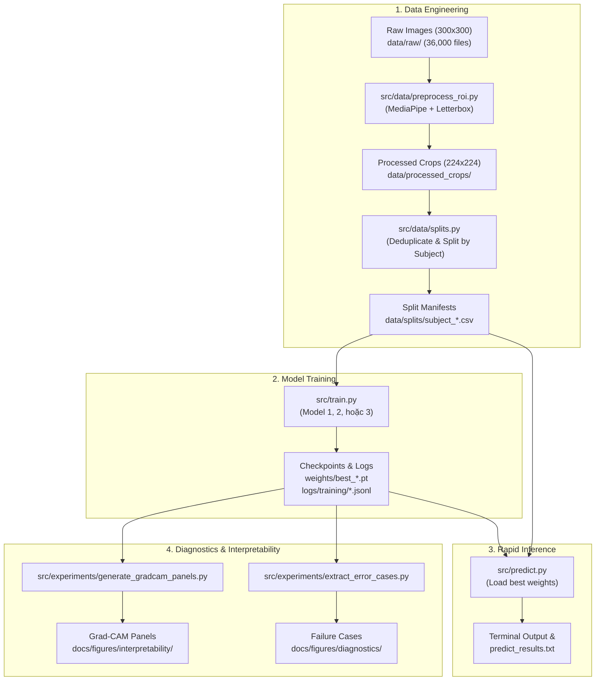
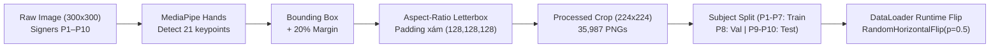
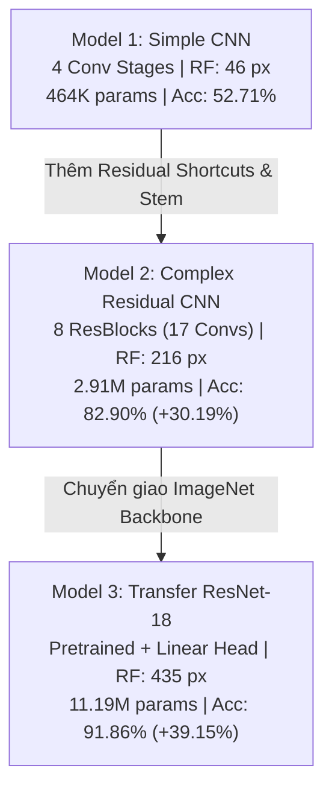
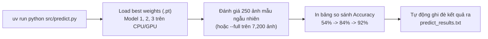

# ASL Recognition: Pipeline Flow Cheat Sheet

Tài liệu tóm tắt luồng hoạt động (pipeline flow) từ đầu đến cuối của toàn bộ repository. Dành cho thành viên nhóm nắm nhanh cấu trúc code, cách dữ liệu di chuyển, logic huấn luyện và phục vụ vấn đáp / viết báo cáo.

---

## 1. High-Level Flow: Toàn Bộ Pipeline Hoạt Động Thế Nào?

Toàn bộ project được tổ chức thành 4 giai đoạn tuần tự: **Data Prep $\to$ Training $\to$ Inference $\to$ Diagnostics**.



---

## 2. Chi Tiết Từng Phần (Step-by-Step Deep Dive)

### Phần 1: Data Engineering Flow (Từ ảnh thô đến DataLoader)



1. **Input**: Tải bộ dữ liệu ASL-HG từ Mendeley Data (36,000 ảnh kích thước $300\times 300$, gồm 10 người làm dấu P1–P10, 36 lớp: `0`–`9`, `A`–`Z`).
2. **Crop & Letterbox (`src/data/preprocess_roi.py`)**:
   - Dùng MediaPipe Hands nhận diện 21 khớp bàn tay để lấy bounding box.
   - **Mở rộng margin 20%** (`MARGIN_FRAC = 0.20`): Bắt buộc phải có để khi người ký co duỗi ngón tay, đầu ngón tay không bao giờ bị cắt cụt khỏi khung hình.
   - **Aspect-ratio Letterboxing**: Bàn tay được scale theo cạnh dài về 224 px, 2 cạnh còn lại bù đệm xám trung tính RGB `(128, 128, 128)`. Tuyệt đối không kéo dẹt (squashing) ảnh vì squashing làm méo tỉ lệ giải phẫu bàn tay và làm tụt tới **29.67% accuracy**.
   - Output: 35,987 ảnh letterbox chuẩn lưu tại `data/processed_crops/` (đã loại 12 ảnh blank hỏng từ raw).
3. **Phân chia tập dữ liệu (`src/data/splits.py`)**:
   - Quét mã băm MD5 để loại 423 frame trùng lặp liên tiếp trong video burst của cùng người ký.
   - **Subject-Independent Split**: Chia triệt để theo người ký:
     - **Train**: P1–P7 (24,777 ảnh)
     - **Validation**: P8 (3,588 ảnh)
     - **Test**: P9 và P10 (7,200 ảnh)
   - *Lưu ý cốt lõi*: Không bao giờ dùng random split ở bài toán này. Các frame liên tiếp trong cùng một burst của một người có perceptual distance $< 1$, nếu random split thì test set sẽ nhìn thấy ảnh gần như giống hệt lúc train, gây ra data leakage làm accuracy ảo lên 99%.
4. **Xử lý thuận tay lúc Runtime (`src/data/dataset.py`)**:
   - 100% dữ liệu gốc trong ASL-HG đều là người ký bằng tay trái (tay phải cầm điện thoại quay).
   - Ký hiệu một tay trong ngôn ngữ ký hiệu mang tính song thủ đối xứng (ambidextrous). Để model nhận diện tốt cả tay trái lẫn tay phải, thay vì nhân đôi 36,000 file trên ổ cứng, ta chèn `RandomHorizontalFlip(p=0.5)` trực tiếp lúc batch loading trong DataLoader. Model tự động học bất biến với tay trái/phải mà tốn 0 MB ổ đĩa phụ.

---

### Phần 2: Model Hierarchy & Training Flow

Dự án phát triển 3 model theo đúng nấc thang tiến hóa kiến trúc:



1. **Model 1: Baseline Simple CNN ([`src/models/simple_cnn.py`](src/models/simple_cnn.py))**:
   - 4 tầng tích chập tuần tự ($3 \to 32 \to 64 \to 128 \to 256$), BatchNorm, ReLU, MaxPool $2\times 2$, MLP classifier với Dropout $p=0.3$.
   - Receptive field hẹp (46 px), không có skip connection $\to$ gradient suy giảm ở các lớp sâu. Đạt **52.71% test accuracy**.
2. **Model 2: Deep Residual CNN ([`src/models/complex_cnn.py`](src/models/complex_cnn.py))**:
   - Huấn luyện từ đầu (from scratch) với 8 khối Residual Block ($F(x) + x$).
   - Có custom stem $3\times 3, s=1$ bảo toàn chi tiết ngón tay ngay từ đầu vào. Receptive field tăng lên 216 px bao phủ toàn bộ bàn tay. Đạt **82.90% test accuracy** (+30.19%).
3. **Model 3: Transfer ResNet-18 ([`src/models/transfer_cnn.py`](src/models/transfer_cnn.py))**:
   - Kế thừa backbone ResNet-18 tiền huấn luyện trên ImageNet-1K, thay head bằng Linear projection trực tiếp (`Linear(512, 36)`).
   - Huấn luyện với Differential Learning Rate: $\eta_{\text{backbone}} = 10^{-4}$, $\eta_{\text{head}} = 5 \times 10^{-4}$, kết hợp Label Smoothing $\alpha=0.10$. Receptive field đạt 435 px. Đạt **91.86% test accuracy** (**23/36 class đạt 100% precision và recall**).
4. **Lệnh Huấn Luyện (`src/train.py`)**:
   - Script điều khiển tinh gọn (78 dòng), nhận tham số `--model`, `--epochs`, `--lr`, `--batch-size`.
   - Kết nối với `src/training/engine.py` (Trainer loop), tự động đánh giá validation F1 mỗi epoch và lưu checkpoint tốt nhất vào `weights/best_model_<name>.pt`.

---

### Phần 3: Inference & Vấn Đáp Flow (`src/predict.py`)

Đây là file quan trọng nhất khi báo cáo thực hành với giảng viên:



- **Mục đích vấn đáp**: Giảng viên yêu cầu học viên phải chạy code trước khi vào bàn vấn đáp và để nguyên màn hình terminal hiển thị kết quả.
- **Cách chạy chuẩn bị trước khi vào thi**:
  ```bash
  # Chạy mặc định: Đánh giá cả 3 model trên 250 ảnh ngẫu nhiên (mất ~3 giây trên CPU)
  uv run python src/predict.py
  ```
- **Các tùy chọn phản xạ nhanh khi giảng viên hỏi**:
  - *Nếu cô yêu cầu chạy toàn bộ 7,200 ảnh test set*:
    `uv run python src/predict.py --full`
  - *Nếu cô bảo chỉ chạy riêng Model 3*:
    `uv run python src/predict.py --model model_3`
  - *Nếu cô đưa 1 ảnh bất kỳ bảo predict xem ra chữ gì*:
    `uv run python src/predict.py --image data/external_crops/B/cbp_B_01.png --model model_3`
- File kết quả: Mọi nội dung hiển thị ở terminal được tự động lưu ra [`predict_results.txt`](predict_results.txt) để mở file cho xem nếu cần.

---

### Phần 4: Explainability (Grad-CAM) & Failure Analysis Flow

Phần này dùng để trả lời câu hỏi lý thuyết sâu: *"Làm sao biết model thực sự nhìn vào bàn tay chứ không học mẹo background hay màu da?"*

1. **Grad-CAM Spatial Attribution ([`src/experiments/generate_gradcam_panels.py`](src/experiments/generate_gradcam_panels.py))**:
   - Sử dụng hook PyTorch tính đạo hàm lớp tích chập cuối:
     $$\alpha_k^c = \frac{1}{Z} \sum_{i, j} \frac{\partial y^c}{\partial A_{i, j}^k}, \quad L_{\text{Grad-CAM}}^c = \mathrm{ReLU}\left(\sum_k \alpha_k^c A^k\right)$$
   - **Sự tiến hóa của vùng chú ý**:
     - *Model 1*: Receptive field hẹp (46 px) khiến heatmap loang lổ, bám vào viền padding.
     - *Model 2*: Bao trọn đường bao quanh bàn tay (hand silhouette).
     - *Model 3*: Hội tụ chính xác vào các đốt ngón tay và khớp quyết định (đầu ngón chữ `B`, nút thắt vòng chữ `O`, chóp ngón cái-ngón út chữ `Y`).
   - Khẳng định tính bất biến: Vùng đệm xám letterbox có **0.00% gradient leakage**.
2. **Phân tích lỗi sai 3 tầng ([`src/experiments/extract_error_cases.py`](src/experiments/extract_error_cases.py))**:
   - Model 3 còn lại 586 mẫu sai trên tập test 7,200 ảnh. Ta phân tích thành 3 nhóm vật lý:
     - **Category A (2D Static Homographs - 36.7%)**: Cặp $6 \leftrightarrow W$ và $2 \leftrightarrow V$. Chiếu 2D đơn mắt không thấy được ngón cái gập vào ngón út ở chiều sâu 3D (bị che bởi lòng bàn tay).
     - **Category B (Dynamic Motion Collapse - 35.5%)**: Cặp $1 \leftrightarrow Z$ và $I \leftrightarrow J$. Chữ Z và J là cử chỉ động (vẽ nét trong không gian). Ảnh chụp tĩnh mất chiều thời gian ($\Delta t = 0$) nên hình thái 2D trùng khớp với chữ 1 và I.
     - **Category C (Bayes Residuals - 27.8%)**: Giới hạn phân giải mặt phẳng ngón cái ($N \leftrightarrow M$, $R \leftrightarrow U$).

---

## 3. Directory Map: Các File Cốt Lõi Cần Nắm Rõ

Bảng ánh xạ các file quan trọng trong repo cần biết vị trí:

| Phân hệ | File chính (**Bắt buộc nắm**) | File hỗ trợ / Output | Ý nghĩa & Vai trò |
| :--- | :--- | :--- | :--- |
| **Dự đoán & Demo** | **`src/predict.py`** | `src/utils/predict_utils.py`<br/>`predict_results.txt` | Entrypoint dự đoán nhanh, chạy demo vấn đáp cho cô xem. |
| **Huấn luyện** | **`src/train.py`** | `src/training/engine.py`<br/>`src/utils/train_utils.py` | Entrypoint huấn luyện model. Quản lý learning rate, early stopping. |
| **Kiến trúc mạng** | **`src/models/transfer_cnn.py`**<br/>**`src/models/complex_cnn.py`**<br/>**`src/models/simple_cnn.py`** | `src/models/__init__.py` | Định nghĩa 3 model của môn học (Model 1, Model 2, Model 3). |
| **Xử lý dữ liệu** | **`src/data/preprocess_roi.py`**<br/>**`src/data/splits.py`** | `src/data/dataset.py`<br/>`src/data/dataloaders.py` | Cắt MediaPipe bàn tay + letterbox xám; chia tập theo người ký P1–P10. |
| **Trọng số Model** | **`weights/best_model_3_transfer_cnn.pt`**<br/>`weights/best_model_2_complex_cnn.pt`<br/>`weights/best_model_1_simple_cnn.pt` | *(Nằm trong bundle zip)* | Checkpoint PyTorch đã train xong của 3 model. |
| **Giải thích & Lỗi** | **`src/experiments/generate_gradcam_panels.py`**<br/>**`src/experiments/extract_error_cases.py`** | `src/utils/gradcam.py`<br/>`src/utils/error_visualizer.py` | Tạo ảnh heatmap Grad-CAM và trích xuất ảnh các case dự đoán sai. |
| **Báo cáo lý thuyết** | **`docs/reports/report_outline.md`** | `docs/reports/*.md` | Dàn ý chi tiết Part 2 để ghép vào bản word nộp bài. |
| **Hình vẽ minh họa** | **`docs/figures/architecture/`**<br/>**`docs/figures/interpretability/`**<br/>**`docs/figures/diagnostics/`** | `docs/figures/dataset/` | Toàn bộ biểu đồ kiến trúc, heatmap, và minh chứng lỗi sai để chèn vào báo cáo. |

---

## 4. Hướng Dẫn Setup Nhanh Cho Thành Viên Mới

Nếu clone repo về máy mà chưa có data hay weights (vì dung lượng lớn bị `.gitignore`):

1. **Cài môi trường**:
   ```bash
   uv sync
   uv run pytest tests/   # Chạy kiểm thử xác nhận 29/29 pass
   ```
2. **Nhận file từ Google Drive**:
   - Tải file `asl_project_bundle.zip` từ Google Drive nhóm.
   - Giải nén đè thẳng vào thư mục gốc của repo. Sẽ có ngay toàn bộ:
     - `data/processed_crops/` (ảnh đã cắt sẵn)
     - `weights/` (weights đã train sẵn của 3 model)
     - `logs/training/` (toàn bộ lịch sử train từng epoch)
3. **Thực thi ngay**:
   ```bash
   uv run python src/predict.py
   ```
   Màn hình sẽ hiển thị bảng kết quả đánh giá cả 3 model sẵn sàng cho buổi vấn đáp.
