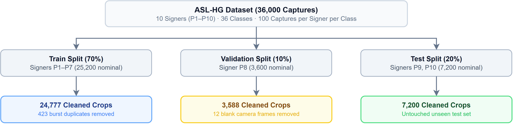

# Dataset Partitioning Protocols and Split Manifests

## 1. Overview

Proper dataset partitioning is essential for building a reliable hand gesture recognition model. Because the ASL-HG dataset was recorded in continuous video bursts, frames captured seconds apart from the same signer share identical lighting, background, skin tone, and clothing. 

If data is split randomly across images, adjacent burst frames land in both training and test sets. When that happens, models score artificially high by memorizing signer-specific backgrounds and clothing rather than learning genuine hand shapes.

To guarantee that models learn generalizable sign representations, we split the data strictly by signer identity: signers in the validation and test sets never appear during training.

The frozen manifests live under [`data/splits/`](../../data/splits/).

---

## 2. Canonical Subject-Independent Split

The primary partitioning protocol follows a Leave-One-Signer-Out (LOSO) strategy, grouping signers into distinct sets:

*Figure 1: Subject-independent dataset partitioning and cleaned sample counts.*

### Partition Summary and Count Breakdown

| Partition | Signers Included | Raw Nominal Captures | Cleaned Manifest Crops | Pruning Rationale |
| :--- | :--- | :--- | :--- | :--- |
| **Train (70%)** | P1, P2, P3, P4, P5, P6, P7 | 25,200 | **24,777** | 423 exact byte-identical duplicate frames removed to prevent loss distortion. |
| **Validation (10%)** | P8 | 3,600 | **3,588** | 12 completely blank camera frames in class 'H' excluded. |
| **Test (20%)** | P9, P10 | 7,200 | **7,200** | Retained fully intact (exactly 200 samples per class across two unseen signers). |
| **Total** | P1–P10 | **36,000** | **35,565** | Cleaned dataset universe across all three partitions. |

### Exclusion and Deduplication Details

1. **Validation Blank Frames**: Signer P8 has 12 corrupted, completely blank frames in class 'H' (`P8_H_778`, `P8_H_780`–`789`, `P8_H_791`). In these frames, the hand had dropped out of the camera's field of view before the capture burst stopped. These 12 frames were pruned because empty frames contain no sign information.
2. **Training Deduplication**: In classes 'I' and 'V', signers P5 and P6 share 199 groups of identical image files (400 files in total). Within each group of byte-identical frames, only the first file was kept in training. Pruning these 423 duplicates prevents over-representing specific static poses in the training loss.
3. **Pristine Test Partition**: Signers P9 and P10 were kept entirely untouched. Every test sample comes from signers the model has never encountered during training or validation.

Manifest files on disk:
- `data/splits/subject_train.csv` (24,777 rows)
- `data/splits/subject_val.csv` (3,588 rows)
- `data/splits/subject_test.csv` (7,200 rows)
- `data/splits/class_mapping.json` (36-class label map)

---

## 3. Secondary Random Stratified Split (Control Baseline)

To scientifically quantify the extent of video burst data leakage, we also generated a standard stratified random split:

- **Universe**: All 35,988 written crops (the 36,000 raw frames minus the 12 corrupted blanks).
- **Proportions**: 70% train, 15% validation, 15% test, stratified uniformly by class label.
- **Manifests**:
  - `data/splits/random_train.csv`: 25,190 images
  - `data/splits/random_val.csv`: 5,399 images
  - `data/splits/random_test.csv`: 5,399 images

### Data Leakage Quantification

Because frames from each recording burst are scattered randomly across partitions, the random split exhibits severe cross-split leakage:
- **Exact hash leakage**: 118 test rows (2.2%) share an exact MD5 hash with an image in the training set.
- **Perceptual hash proximity**: Over 86% of test images have a training image within a perceptual dHash distance of $\le 1$ (near-identical duplicate poses from the same video burst).
- **Cross-partition copy groups**: 221 out of 435 duplicate hash groups cross split boundaries.

As documented in [`ablation_experiments.md`](ablation_experiments.md), this leakage artificially inflates Model 1 test accuracy from **52.71% to 90.72% (+38.01%)** and Model 3 to a deceptive **100.00%**. This confirms why subject-independent splitting is essential for honest evaluation.

---

## 4. Out-of-Distribution External Benchmark

To test real-world generalization beyond the laboratory conditions of the ASL-HG dataset, we collected an independent benchmark dataset under uncontrolled conditions.

*Figure 2: Distribution of the 180 out-of-distribution real-world evaluation captures.*

### Benchmark Composition

The dataset contains 180 images across all 36 classes, stored in `data/external_test/`:
- **Diverse participants**: Four human volunteers (`cbp`, `hck`, `ntt`, `phm`) with varying hand sizes and skin tones.
- **Uncontrolled environments**: Captures include indoor dorm rooms, offices, outdoor ambient lighting, and natural background clutter.
- **Hardware diversity**: Images were taken using consumer smartphone cameras and integrated laptop webcams.
- **Controlled handedness evaluation**: Participant `hck` contributed 36 original right-handed captures and 36 horizontally mirrored left-handed images. This paired 72-image subset directly tests model ambidexterity.

Detailed benchmark results and per-signer error analyses are documented in [`external_benchmark.md`](external_benchmark.md).

---

## 5. Summary of Partition Manifests

| Protocol | Split Identifier | Sample Count | Primary Use Case |
| :--- | :--- | :--- | :--- |
| **Subject-Independent** | `subject_train.csv` | 24,777 | Core model training (Signers P1–P7). |
| **Subject-Independent** | `subject_val.csv` | 3,588 | Early stopping and checkpoint selection (Signer P8). |
| **Subject-Independent** | `subject_test.csv` | 7,200 | Final model evaluation on unseen signers (Signers P9, P10). |
| **Stratified Random** | `random_train.csv` | 25,190 | Baseline training to quantify data leakage in Ablation 1. |
| **Stratified Random** | `random_val.csv` | 5,399 | Hyperparameter tuning under random split baseline. |
| **Stratified Random** | `random_test.csv` | 5,399 | Quantifies optimistic performance bias from burst leakage. |
| **External Benchmark** | `data/external_test/` | 180 | Zero-shot evaluation under real-world domain shifts and handedness parity. |