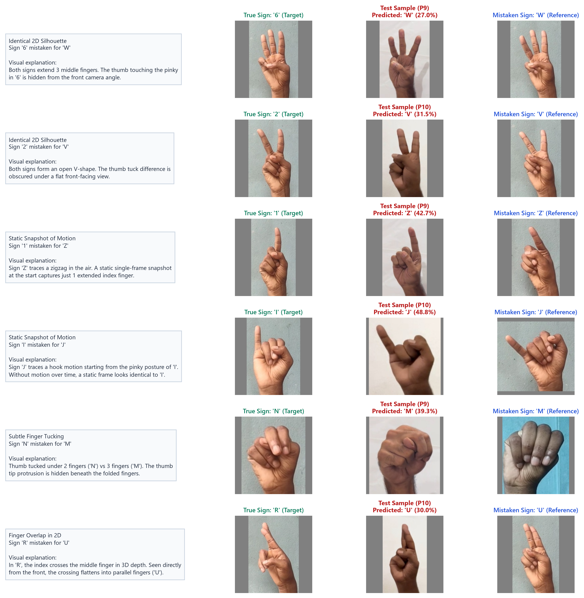
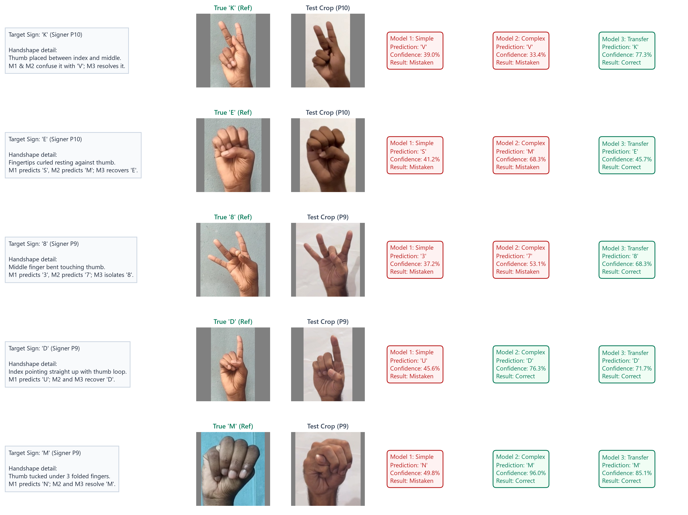
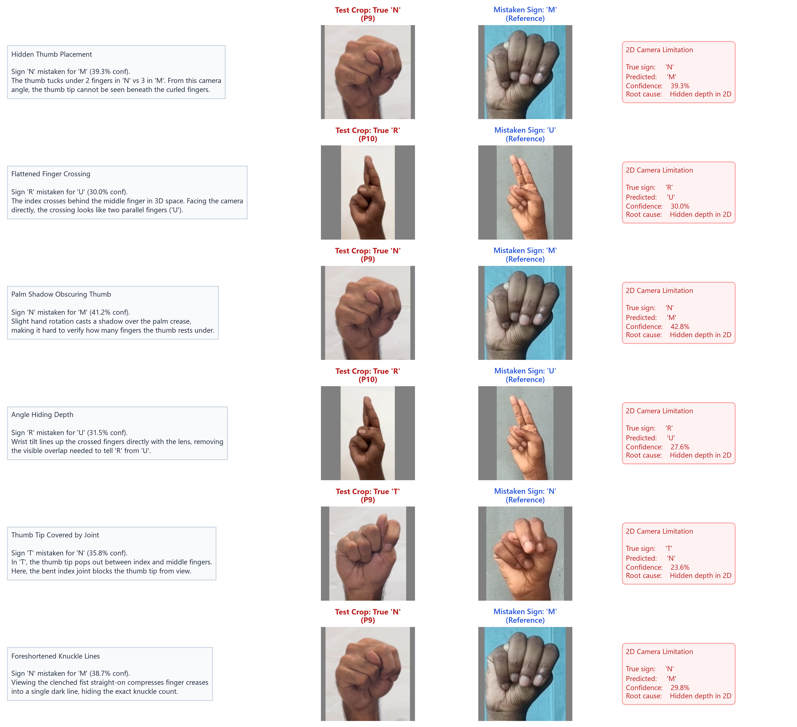

# Deep Per-Class Diagnostics and Qualitative Failure Analysis

## 1. Executive Diagnostic Synthesis

Evaluating neural network architectures on unseen subjects exposes the failure modes that random train-validation splits mask. In cross-subject evaluation on Signers P9 and P10 (7,200 images, exactly 200 samples per class across 36 ASL alphabet and numeral classes), performance scales with architectural depth and feature transfer:

- **Model 1 (Simple CNN, ~464K parameters)**: 52.71% test accuracy, 54.47% macro precision, 49.20% macro F1. Suffers from severe structural confusion and underfitting on fine morphological distinctions.
- **Model 2 (Deep Residual CNN, ~2.91M parameters)**: 82.90% test accuracy, 87.34% macro precision, 81.78% macro F1. Residual skip connections resolve global finger-count ambiguity and gross handshape structure, but residual confusions remain on static homographs and dynamic motion signs.
- **Model 3 (Fine-Tuned ResNet-18, ~11.19M parameters)**: 91.86% test accuracy, 93.12% macro precision, 91.10% macro F1. Pretrained multi-scale edge and texture representations resolve 23 anchor classes to 100% precision and recall. Remaining errors concentrate in 5 distinct classes (`6`, `1`, `I`, `N`, `R`), which account for 486 of the 586 total misclassifications (82.9%).

The remaining failure modes partition into three distinct diagnostic tiers:
1. **Category A (Static 2D Homographs)**: Structurally homeomorphic 2D silhouettes where 3D depth separation collapses under monocular orthographic projection ($6 \leftrightarrow W$, $2 \leftrightarrow V$, $K \leftrightarrow V$).
2. **Category B (Dynamic Motion Collapse)**: Static single-frame ambiguity of dynamic ASL signs where stroke trajectories are lost ($1 \leftrightarrow Z$, $I \leftrightarrow J$).
3. **Category C (Morphological and Articulation Nuance)**: Subtle inter-digital occlusion, thumb tuck depth, and overlapping joint kinematics ($N \leftrightarrow M$, $R \leftrightarrow U$, $T \leftrightarrow N$).

---

## 2. Standardized Error Tier Decomposition

### Category A: Static 2D Homographs

Static 2D homographs arise when distinct 3D ASL hand gestures produce identical 2D silhouette boundaries under anterior camera projection.

*Figure 1: Why signs '6' and 'W' confuse a 2D camera. Looking straight at the palm, both signs share an outer boundary of three extended fingers, while the distinguishing thumb-pinky contact is hidden behind the palm.*

- **Confused Pair $6 \leftrightarrow W$**:
  - *Empirical Impact*: For Model 3, class $6$ produces 182 errors out of 200 samples (91.0% error rate; Precision = 0.353, Recall = 0.090), with 182 predicting $W$. Reciprocally, class $W$ generates 33 errors predicting $6$. Across all three models, Model 1 achieves 0.000 F1 on $6$, Model 2 achieves 0.000 F1 on $6$, and Model 3 reaches only 0.143 F1.
  - *Biomechanical Root Cause*: In sign $6$, the distal phalanx of the thumb opposes the distal phalanx of the pinky, forming a contact loop while the index, middle, and ring fingers remain fully extended (metacarpophalangeal MCP flexion $0^\circ$). In sign $W$, the thumb folds across the palm to pin the pinky distal phalanx against the palm surface, while index, middle, and ring fingers extend. From a planar camera perspective perpendicular to the palm, the thumb-pinky contact point is occluded by the palm volume and wrist foreshortening. The bounding contour is dominated by three extended vertical digits.
- **Confused Pair $2 \leftrightarrow V$ and $K \leftrightarrow V$**:
  - *Empirical Impact*: Model 1 confuses $2$ and $V$ extensively (Model 1 $2$ Precision = 0.421, $V$ Precision = 0.483). Model 2 struggles with $V$ (Recall = 0.235). Model 3 largely resolves $2 \leftrightarrow V$ (Precision = 0.974, Recall = 0.950, only 10 errors $2 \to V$ and 5 errors $V \to 2$), while $K \leftrightarrow V$ is fully isolated by Model 3 (Class $K$ achieves 100% Precision and Recall).
  - *Biomechanical Root Cause*: Both signs feature an open V-shape formed by extended index and middle fingers. The sole discriminant is thumb placement: in $2$, the thumb rests folded inward over the ring and pinky distal interphalangeal (DIP) joints; in $V$, the thumb flexes across the ring finger proximal interphalangeal (PIP) joint. In $K$, the thumb tip wedges vertically between index and middle proximal phalanges. Without high-frequency edge isolation of the thumb knuckle, shallow networks collapse these into a single V-profile.

---

### Category B: Dynamic Motion Collapse

In natural American Sign Language, several alphabet letters require dynamic stroke motion rather than a static hand posture. When recorded in static datasets, dynamic signs collapse into single freeze-frames.

- **Confused Pair $1 \leftrightarrow Z$**:
  - *Empirical Impact*: Model 3 misclassifies 108 of 200 samples of class $1$ as $Z$ (Recall = 0.460). Conversely, class $Z$ achieves 100% recall with 0 errors, but its precision drops to 0.649 due to false positive influx from $1$.
  - *Biomechanical Root Cause*: Sign $Z$ is articulated dynamically by extending the index finger and tracing a zigzag path in space. When captured as a static snapshot at the stroke initiation or termination, the hand configuration is identical to sign $1$: a single extended index finger with the remaining digits clenched against the palm. A static 2D vision model possesses zero temporal receptive field ($\Delta t = 0$), rendering $1$ and static $Z$ mathematically indistinguishable.
- **Confused Pair $I \leftrightarrow J$**:
  - *Empirical Impact*: Model 3 misclassifies 100 of 200 samples of class $I$ as $J$ (Precision = 1.000, Recall = 0.500). Class $J$ exhibits 100% recall with 0 errors and a precision of 0.667.
  - *Biomechanical Root Cause*: Sign $J$ begins in the handshape of sign $I$ (fist closed, pinky finger extended) and traces a curved hook in space via wrist supination. In static frames where the dynamic hook is not visible or captured at stroke onset, the static contour matches sign $I$.

---

### Category C: Morphological and Articulation Nuance

Category C errors represent fine-grained anatomical variations involving finger tucks and joint flexions.

- **Confused Pair $N \leftrightarrow M$**:
  - *Empirical Impact*: Model 3 misclassifies 81 of 200 samples of class $N$ as $M$ (Precision = 0.983, Recall = 0.595). In Model 1, class $M$ suffered total collapse (0.000 F1). In Model 2, $M$ recovered to 0.664 F1. In Model 3, $M$ achieves 100% recall (Precision = 0.712, F1 = 0.832).
  - *Biomechanical Root Cause*: Both signs require a clenched fist with the thumb folded under extended digits. In $M$, the thumb rests beneath three fingers (index, middle, ring), protruding between ring and pinky fingers. In $N$, the thumb rests beneath two fingers (index, middle), protruding between middle and ring fingers. Under downward perspective foreshortening or slight wrist rotation, the lateral protrusion of the thumb tip is occluded behind the flexed proximal phalanges.
- **Confused Pair $R \leftrightarrow U$**:
  - *Empirical Impact*: Model 3 misclassifies 65 of 200 samples of class $R$ as $U$ (Precision = 1.000, Recall = 0.675). Class $U$ achieves 100% recall with Precision = 0.755.
  - *Biomechanical Root Cause*: Sign $U$ requires extended index and middle fingers held parallel and in contact. Sign $R$ requires crossing the middle finger behind or over the index finger in 3D space. When the signer's hand orientation is aligned directly along the optical line of sight, the 3D crossover flattens into parallel boundaries, projecting identical outer contours to $U$.
- **Confused Pair $T \leftrightarrow N$**:
  - *Empirical Impact*: Model 3 misclassifies only 2 samples of $T$ as $N$ (Recall = 0.990).
  - *Biomechanical Root Cause*: In $T$, the thumb tucks under a single finger (index). In $N$, it tucks under two. Slight PIP flexion overlap creates a borderline contour.

---

### Anchor Invariant Classes

Twenty-three of the 36 classes achieve 100.0% precision and 100.0% recall simultaneously in Model 3 (`0`, `3`, `4`, `5`, `7`, `8`, `9`, `A`, `B`, `C`, `D`, `E`, `F`, `G`, `H`, `K`, `L`, `O`, `P`, `Q`, `S`, `X`, `Y`). Two classes (`0` and `5`) achieve 100.0% precision and recall across all three architectures.

The biomechanical invariants that protect these classes include:
1. **Geometric Topology**: Sign $0$ forms an enclosed ovoid loop across all five digits. Sign $C$ forms an open semicircular arc. Sign $L$ exhibits an orthogonal $90^\circ$ radial abduction between index and thumb. Sign $5$ exhibits maximal abduction and full extension across all digits ($MCP=0^\circ, PIP=0^\circ, DIP=0^\circ$).
2. **Distinct Aspect Ratio and Extreme Extremities**: Sign $B$ projects an extended four-finger vertical blade with folded thumb. Sign $Y$ projects opposing radial and ulnar protrusions (thumb and pinky extended, intermediate three digits flexed).
3. **Absence of Shared Silhouette Competitors**: These classes occupy isolated clusters in handshape space. Their convex hull and contour curvature extrema share no overlap with other ASL signs.

---

## 3. Qualitative Failure Visualizations

### Tri-Panel Failure Comparisons

The tri-panel diagnostic figure juxtaposes canonical training references against unseen test failure samples and predicted canonical classes.

*Figure 2: Tri-Panel diagnostic failure comparisons across Category A (Static 2D Homographs: $6 \leftrightarrow W$, $2 \leftrightarrow V$), Category B (Dynamic Motion Collapse: $1 \leftrightarrow Z$, $I \leftrightarrow J$), and Category C (Morphological Nuance: $N \leftrightarrow M$, $R \leftrightarrow U$). Each row presents [Canonical Ground Truth] | [Actual Test Crop (P9/P10)] | [Canonical Predicted Class] with annotated biomechanical root causes.*

---

### Architectural Progression Montage

Tracking specific difficult samples across architectures demonstrates how representational capacity evolves from shallow sequential convolution to deep residual skip networks and pretrained transfer learning.

*Figure 3: Architectural progression montage demonstrating error recovery across Model 1 (Simple CNN), Model 2 (Deep Residual CNN), and Model 3 (Transfer Learning ResNet-18) on representative diagnostic test samples ($K$, $E$, $8$, $D$, $M$).*

- **Sign $K$ (Signer P10)**: Model 1 predicts $V$ (39.0%), Model 2 predicts $V$ (33.4%), Model 3 correctly predicts $K$ (77.3%). The thumb wedged between index and middle fingers requires fine-grained edge sensitivity that only pretrained multi-scale filters isolate.
- **Sign $E$ (Signer P10)**: Model 1 predicts $S$ (41.2%), Model 2 predicts $M$ (68.3%), Model 3 resolves to $E$ (45.7%). Curled fingertips resting against the thumb produce complex self-shadowing that confuses shallow models.
- **Sign $8$ (Signer P9)**: Model 1 predicts $3$ (37.2%), Model 2 predicts $7$ (53.1%), Model 3 correctly identifies $8$ (68.3%). Detecting the bent middle finger contacting the thumb against extended index, ring, and pinky requires resolving finger identity without spatial misassignment.
- **Sign $D$ (Signer P9)**: Model 1 predicts $U$ (45.6%), Model 2 resolves to $D$ (76.3%), Model 3 resolves to $D$ (71.7%). The closed loop formed by middle, ring, pinky, and thumb is captured once residual connections preserve spatial feature localization.
- **Sign $M$ (Signer P9)**: Model 1 predicts $N$ (49.8%), Model 2 resolves to $M$ (96.0%), Model 3 resolves to $M$ (85.1%).

---

### Bayes Error Bound Residual Analysis

Model 3 achieves 91.86% overall accuracy, leaving 586 misclassifications. Of these, 438 errors stem from homograph and dynamic ambiguity ($6 \leftrightarrow W$ with 215 errors, $1 \leftrightarrow Z$ with 108 errors, $I \leftrightarrow J$ with 100 errors, $2 \leftrightarrow V$ with 15 errors). The remaining 148 errors represent the Bayes error bound residual under monocular 2D RGB sensing.

*Figure 4: Bayes error bound residual analysis documenting irreducible 2D projection ambiguities in Model 3 (ResNet-18) caused by finger overlap flattening, knuckle shadowing, and perspective foreshortening.*

1. **Thumb Interposition Occlusion ($N \to M$, Signer P9, 39.3% confidence)**: Thumb position under two versus three digits is hidden by downward camera perspective.
2. **Coplanar Finger Overlap Flattening ($R \to U$, Signer P10, 30.0% confidence)**: Crossing of index and middle fingers in 3D aligns with the line of sight, flattening into parallel edges homeomorphic to $U$.
3. **Subtle Metacarpal Knuckle Shadowing ($N \to M$, Signer P9, 41.2% confidence)**: Deep palm crease shadows obscure lateral thumb reach.
4. **Out-of-Plane Depth Ambiguity ($R \to U$, Signer P10, 31.5% confidence)**: Slight wrist supination aligns digits vertically, destroying crossing evidence.
5. **Inter-Digital Occlusion ($T \to N$, Signer P9, 35.8% confidence)**: Thumb tip in sign $T$ is obscured by index PIP joint flexion.
6. **DIP Joint Self-Occlusion ($N \to M$, Signer P9, 38.7% confidence)**: Foreshortening compresses inter-phalangeal creases into a single dark edge boundary.

Without depth sensing (RGB-D) or temporal multi-frame sequences, these 148 residual errors represent an information-theoretic lower bound on monocular 2D classification error.

---

## 4. Quantitative Per-Class Evaluation

### Markdown Evaluation Summary

The table below details per-class Precision, Recall, F1-Score, and Model 3 Error Counts across all 36 classes evaluated on unseen signers P9 and P10 (Support = 200 per class, 7,200 test images total).

|     Class     |  Support  | Model 1 Prec | Model 1 Rec | Model 1 F1 | Model 2 Prec | Model 2 Rec | Model 2 F1 | Model 3 Prec | Model 3 Rec | Model 3 F1 | M3 Errors |
| :-----------: | :-------: | :----------: | :---------: | :--------: | :----------: | :---------: | :--------: | :----------: | :---------: | :--------: | :-------: |
|     **0**     |    200    |    1.000     |    1.000    |   1.000    |    1.000     |    1.000    |   1.000    |    1.000     |    1.000    |   1.000    |     0     |
|     **1**     |    200    |    0.258     |    0.125    |   0.168    |    1.000     |    0.530    |   0.693    |    1.000     |    0.460    |   0.630    |    108    |
|     **2**     |    200    |    0.421     |    0.775    |   0.546    |    0.567     |    1.000    |   0.723    |    0.974     |    0.950    |   0.962    |    10     |
|     **3**     |    200    |    0.007     |    0.005    |   0.006    |    0.913     |    1.000    |   0.955    |    1.000     |    1.000    |   1.000    |     0     |
|     **4**     |    200    |    0.872     |    0.615    |   0.721    |    1.000     |    1.000    |   1.000    |    1.000     |    1.000    |   1.000    |     0     |
|     **5**     |    200    |    1.000     |    1.000    |   1.000    |    1.000     |    1.000    |   1.000    |    1.000     |    1.000    |   1.000    |     0     |
|     **6**     |    200    |    0.000     |    0.000    |   0.000    |    0.000     |    0.000    |   0.000    |    0.353     |    0.090    |   0.143    |    182    |
|     **7**     |    200    |    0.727     |    0.440    |   0.548    |    0.546     |    1.000    |   0.707    |    1.000     |    1.000    |   1.000    |     0     |
|     **8**     |    200    |    0.346     |    0.410    |   0.375    |    1.000     |    0.170    |   0.291    |    1.000     |    1.000    |   1.000    |     0     |
|     **9**     |    200    |    0.000     |    0.000    |   0.000    |    1.000     |    0.605    |   0.754    |    1.000     |    1.000    |   1.000    |     0     |
|     **A**     |    200    |    1.000     |    0.735    |   0.847    |    1.000     |    1.000    |   1.000    |    1.000     |    1.000    |   1.000    |     0     |
|     **B**     |    200    |    0.966     |    1.000    |   0.983    |    1.000     |    0.880    |   0.936    |    1.000     |    1.000    |   1.000    |     0     |
|     **C**     |    200    |    1.000     |    0.500    |   0.667    |    0.772     |    1.000    |   0.871    |    1.000     |    1.000    |   1.000    |     0     |
|     **D**     |    200    |    0.000     |    0.000    |   0.000    |    1.000     |    1.000    |   1.000    |    1.000     |    1.000    |   1.000    |     0     |
|     **E**     |    200    |    0.000     |    0.000    |   0.000    |    1.000     |    0.500    |   0.667    |    1.000     |    1.000    |   1.000    |     0     |
|     **F**     |    200    |    1.000     |    0.360    |   0.529    |    1.000     |    0.995    |   0.997    |    1.000     |    1.000    |   1.000    |     0     |
|     **G**     |    200    |    0.000     |    0.000    |   0.000    |    1.000     |    1.000    |   1.000    |    1.000     |    1.000    |   1.000    |     0     |
|     **H**     |    200    |    0.631     |    1.000    |   0.774    |    1.000     |    1.000    |   1.000    |    1.000     |    1.000    |   1.000    |     0     |
|     **I**     |    200    |    1.000     |    0.090    |   0.165    |    1.000     |    0.500    |   0.667    |    1.000     |    0.500    |   0.667    |    100    |
|     **J**     |    200    |    0.851     |    0.515    |   0.642    |    0.667     |    1.000    |   0.800    |    0.667     |    1.000    |   0.800    |     0     |
|     **K**     |    200    |    1.000     |    0.700    |   0.824    |    1.000     |    0.945    |   0.972    |    1.000     |    1.000    |   1.000    |     0     |
|     **L**     |    200    |    1.000     |    0.610    |   0.758    |    1.000     |    1.000    |   1.000    |    1.000     |    1.000    |   1.000    |     0     |
|     **M**     |    200    |    0.000     |    0.000    |   0.000    |    0.498     |    1.000    |   0.664    |    0.712     |    1.000    |   0.832    |     0     |
|     **N**     |    200    |    0.492     |    0.485    |   0.489    |    0.961     |    0.490    |   0.649    |    0.983     |    0.595    |   0.741    |    81     |
|     **O**     |    200    |    0.926     |    0.500    |   0.649    |    1.000     |    1.000    |   1.000    |    1.000     |    1.000    |   1.000    |     0     |
|     **P**     |    200    |    0.707     |    1.000    |   0.828    |    0.885     |    1.000    |   0.939    |    1.000     |    1.000    |   1.000    |     0     |
|     **Q**     |    200    |    0.504     |    1.000    |   0.670    |    1.000     |    1.000    |   1.000    |    1.000     |    1.000    |   1.000    |     0     |
|     **R**     |    200    |    1.000     |    0.770    |   0.870    |    1.000     |    1.000    |   1.000    |    1.000     |    0.675    |   0.806    |    65     |
|     **S**     |    200    |    0.510     |    0.500    |   0.505    |    1.000     |    1.000    |   1.000    |    1.000     |    1.000    |   1.000    |     0     |
|     **T**     |    200    |    0.536     |    0.920    |   0.678    |    1.000     |    0.980    |   0.990    |    1.000     |    0.990    |   0.995    |     2     |
|     **U**     |    200    |    0.525     |    1.000    |   0.688    |    0.889     |    1.000    |   0.941    |    0.755     |    1.000    |   0.860    |     0     |
|     **V**     |    200    |    0.483     |    0.985    |   0.648    |    0.810     |    0.235    |   0.364    |    0.951     |    0.975    |   0.963    |     5     |
|     **W**     |    200    |    0.007     |    0.005    |   0.006    |    0.253     |    0.440    |   0.321    |    0.479     |    0.835    |   0.608    |    33     |
|     **X**     |    200    |    0.103     |    0.500    |   0.171    |    1.000     |    0.575    |   0.730    |    1.000     |    1.000    |   1.000    |     0     |
|     **Y**     |    200    |    0.420     |    1.000    |   0.592    |    1.000     |    1.000    |   1.000    |    1.000     |    1.000    |   1.000    |     0     |
|     **Z**     |    200    |    0.317     |    0.430    |   0.365    |    0.680     |    1.000    |   0.810    |    0.649     |    1.000    |   0.787    |     0     |
| **Macro Avg** | **7,200** |  **0.545**   |  **0.527**  | **0.492**  |  **0.873**   |  **0.829**  | **0.818**  |  **0.931**   |  **0.919**  | **0.911**  |  **586**  |

