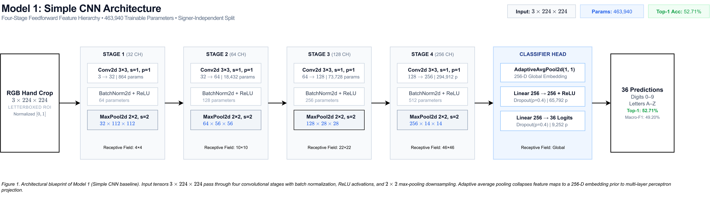
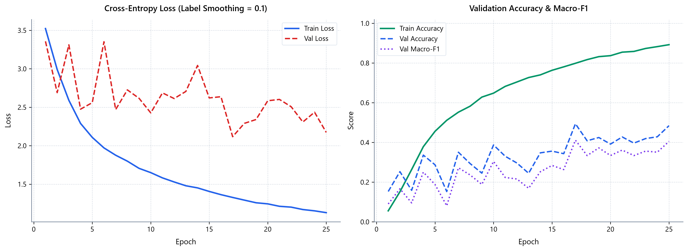
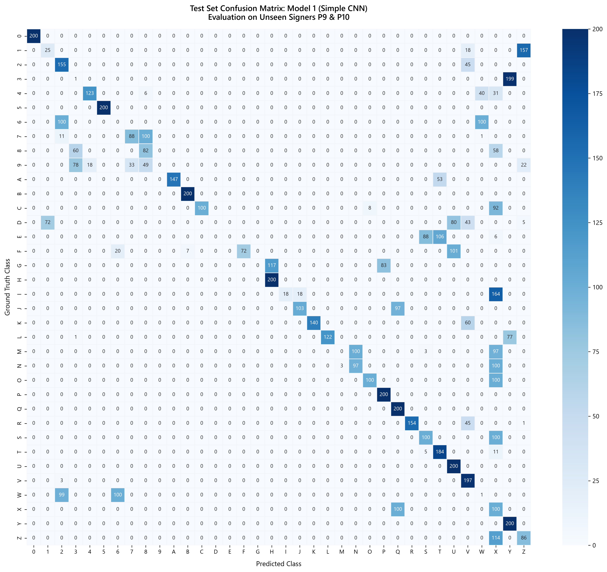

# Baseline Model Architecture: Simple Convolutional Neural Network

## 1. Overview and Design Objectives

The baseline architecture adheres strictly to a classical, non-residual feed-forward convolutional paradigm. It relies exclusively on standard convolutional, batch normalization, non-linear activation, spatial subsampling, global pooling, and dense classification layers.

The objective of this design is to establish a rigorous, transparent reference benchmark on the ASL Fingerspelling dataset (36 alphanumeric classes) under signer-independent evaluation conditions before introducing residual pathways or transfer learning backbones.

### Architecture Blueprint

*Figure 1. Architectural blueprint of Model 1 (Simple CNN baseline). The 463,940 parameter network processes $3 \times 224 \times 224$ letterboxed hand crops through four sequential convolutional stages with batch normalization, ReLU non-linearities, and max-pooling, feeding an adaptive average pooling global embedding and multi-layer perceptron projection head.*

*High-resolution vector graphic: [model_1_architecture_detailed.svg](../figures/architecture/model_1_architecture_detailed.svg); compressed pipeline notation: *

---

## 2. Detailed Layer Specifications and Tensor Geometry

The feature extraction hierarchy consists of four sequential downsampling stages followed by global spatial aggregation and a regularized multi-layer perceptron (MLP) classification head.

| Stage / Layer         | Component Type         | Kernel / Stride / Padding  | Input Dimensions           | Output Dimensions          | Trainable Parameters |
| :-------------------- | :--------------------- | :------------------------- | :------------------------- | :------------------------- | :------------------- |
| **Input**             | RGB Tensor             | —                          | —                          | $3 \times 224 \times 224$  | 0                    |
| **Stage 1: Conv**     | `Conv2d`               | $3 \times 3$, $s=1$, $p=1$ | $3 \times 224 \times 224$  | $32 \times 224 \times 224$ | 864                  |
| **Stage 1: Norm/Act** | `BatchNorm2d` + `ReLU` | —                          | $32 \times 224 \times 224$ | $32 \times 224 \times 224$ | 64                   |
| **Stage 1: Pool**     | `MaxPool2d`            | $2 \times 2$, $s=2$        | $32 \times 224 \times 224$ | $32 \times 112 \times 112$ | 0                    |
| **Stage 2: Conv**     | `Conv2d`               | $3 \times 3$, $s=1$, $p=1$ | $32 \times 112 \times 112$ | $64 \times 112 \times 112$ | 18,432               |
| **Stage 2: Norm/Act** | `BatchNorm2d` + `ReLU` | —                          | $64 \times 112 \times 112$ | $64 \times 112 \times 112$ | 128                  |
| **Stage 2: Pool**     | `MaxPool2d`            | $2 \times 2$, $s=2$        | $64 \times 112 \times 112$ | $64 \times 56 \times 56$   | 0                    |
| **Stage 3: Conv**     | `Conv2d`               | $3 \times 3$, $s=1$, $p=1$ | $64 \times 56 \times 56$   | $128 \times 56 \times 56$  | 73,728               |
| **Stage 3: Norm/Act** | `BatchNorm2d` + `ReLU` | —                          | $128 \times 56 \times 56$  | $128 \times 56 \times 56$  | 256                  |
| **Stage 3: Pool**     | `MaxPool2d`            | $2 \times 2$, $s=2$        | $128 \times 56 \times 56$  | $128 \times 28 \times 28$  | 0                    |
| **Stage 4: Conv**     | `Conv2d`               | $3 \times 3$, $s=1$, $p=1$ | $128 \times 28 \times 28$  | $256 \times 28 \times 28$  | 294,912              |
| **Stage 4: Norm/Act** | `BatchNorm2d` + `ReLU` | —                          | $256 \times 28 \times 28$  | $256 \times 28 \times 28$  | 512                  |
| **Stage 4: Pool**     | `MaxPool2d`            | $2 \times 2$, $s=2$        | $256 \times 28 \times 28$  | $256 \times 14 \times 14$  | 0                    |
| **Global Pooling**    | `AdaptiveAvgPool2d`    | target $(1 \times 1)$      | $256 \times 14 \times 14$  | $256 \times 1 \times 1$    | 0                    |
| **Head: Flatten**     | `Flatten`              | —                          | $256 \times 1 \times 1$    | 256                        | 0                    |
| **Head: Reg 1**       | `Dropout` ($p=0.4$)    | —                          | 256                        | 256                        | 0                    |
| **Head: Dense 1**     | `Linear` + `ReLU`      | —                          | 256                        | 256                        | 65,792               |
| **Head: Reg 2**       | `Dropout` ($p=0.4$)    | —                          | 256                        | 256                        | 0                    |
| **Head: Output**      | `Linear`               | —                          | 256                        | 36                         | 9,252                |

- **Feature Extractor Parameters**: 388,896
- **Classification Head Parameters**: 75,044
- **Total Trainable Parameters**: **463,940** (compact budget under 500k parameters).

---

## 3. Design Rationale and Architectural Justifications

Every architectural primitive in Model 1 is calibrated to establish an interpretable, mathematically sound, non-residual baseline under a strict sub-500k parameter budget.

### Input Specification: $3 \times 224 \times 224$ RGB
- **Spatial Resolution ($224 \times 224$ vs. $64 \times 64$ or $112 \times 112$)**: ASL fingerspelling phonology relies on fine distal knuckle articulation, inter-finger contact, and subtle thumb tuck positions (e.g., distinguishing `M`, `N`, and `T`). Downsampling inputs to $64 \times 64$ eliminates these high-frequency anatomical boundaries across letterboxed bounding boxes. $224 \times 224$ preserves sub-millimeter finger separation while maintaining exact input dimension parity with Model 2 and Model 3 for rigorous, controlled comparative evaluation.
- **Color Space (3-Channel RGB vs. Grayscale)**: Grayscale conversion collapses chromatic contrast between skin tones and varied classroom backgrounds into luminance. Multi-channel RGB preserves chromatic cast shadows in inter-digital clefts, providing critical depth cues under monocular 2D imaging.

### Channel Hierarchy and Capacity Budget ($32 \to 64 \to 128 \to 256$)
- **Pyramidal Doubling**: Halving spatial dimensions ($H/2, W/2$) while doubling feature depth ($2C$) preserves a constant representational volume per layer ($C \times H \times W$), maintaining balanced computational FLOP density across all four stages.
- **Budget Capping at 256 Channels (463,940 Parameters)**: Capping stage 4 at 256 channels enforces an inductive capacity ceiling under 500k weights. Expanding to 512 channels would inflate parameters to ~1.8M without residual highways, exacerbating optimization instability and severe overfitting to the 7 training signers. This establishes a lean reference point to measure the isolated gains of residual shortcuts (Model 2) and pretrained feature transfer (Model 3).

### Convolutional Operator: $3 \times 3$, Stride 1, Padding 1
- **$3 \times 3$ vs. $5 \times 5$ or $7 \times 7$ Kernels**: Following Simonyan & Zisserman (VGG), stacking two $3 \times 3$ convolutions yields an effective receptive field of $5 \times 5$ with $2 \times (3^2 \cdot C^2) = 18C^2$ weights, compared to $5^2 \cdot C^2 = 25C^2$ for a single $5 \times 5$ kernel (28% parameter reduction). Concurrently, smaller kernels introduce additional intermediate non-linearities, increasing discriminative capacity per parameter.
- **Omission of Convolutional Bias (`bias=False`)**: Every convolutional layer directly feeds a `BatchNorm2d` layer. Because batch normalization centers intermediate activations via mini-batch subtraction $\hat{x} = \frac{(Wx + b) - \mu_B}{\sigma_B}$, the scalar bias $b$ cancels identically ($\mu_B = \frac{1}{m}\sum(Wx_i + b) = \mu_{Wx} + b$). Retaining bias introduces redundant unregularized degrees of freedom that induce gradient drift; omitting it eliminates 480 extraneous parameters without representational loss.

### Normalization and Activation Dynamics
- **Batch Normalization**: Deep non-residual networks suffer from internal covariate shift and exploding/vanishing gradients during early training. `BatchNorm2d` re-centers and scales activations at each stage, smoothing the optimization landscape and enabling a high initial learning rate ($5.0 \times 10^{-4}$) without divergence.
- **ReLU vs. LeakyReLU / GELU**: ReLU ($f(x) = \max(0, x)$) introduces exact zeros, inducing representational sparsity and minimal floating-point computational overhead. In a pure feed-forward baseline where dead-neuron collapse was monitored and absent, parametric or smooth activations (GELU/Swish) introduce computational cost without measurable empirical gain in shallow non-residual settings.

### Spatial Subsampling: MaxPool2d ($2 \times 2$, Stride 2)
- **MaxPool vs. Strided Convolution vs. Average Pooling**: Average pooling acts as a spatial low-pass filter, blurring finger silhouettes and edge boundaries in early stages. Strided convolutions add trainable parameters prone to aliasing on small datasets. Max-pooling non-linearly selects dominant edge and knuckle activations within each $2 \times 2$ patch, providing translation pseudo-invariance with zero parameter overhead.

### Global Spatial Aggregation: Adaptive Average Pooling vs. Dense Flattening
- **Global Average Pooling (`AdaptiveAvgPool2d((1, 1))`)**: Directly flattening the Stage 4 feature map ($256 \times 14 \times 14 = 50,176$ activations) into a 256-D dense layer would require $50,176 \times 256 \approx 12.84\times 10^6$ parameters, dominating >96% of the entire network. Such unconstrained fully connected capacity memorizes signer-specific spatial positions, causing catastrophic failure under cross-subject testing.
- **Mechanism**: Global average pooling collapses spatial dimensions to a clean 256-D channel descriptor without trainable parameters, enforcing full translation invariance across letterboxed hand crops.

### Classification Head: 2-Stage MLP with Dual Dropout ($p=0.4$)
- **2-Stage MLP vs. Single Linear Projection**: In shallow sequential networks, feature representations at the pooling boundary are not yet linearly separable for 36 classes. An intermediate dense layer (`Linear(256, 256)` + ReLU) acts as a non-linear coordinate warping stage before the final 36-way projection.
- **Heavy Regularization ($p = 0.4$)**: Under subject-independent splits, signers introduce stark anatomical and luminance domain shifts. Placing dual dropout layers before each dense transformation destroys co-adaptations between pooled features, preventing individual channels from overfitting to idiosyncratic signer artifacts.

---

## 4. Theoretical Receptive Field Propagation

The effective receptive field ($RF$) evolves sequentially through convolutional and pooling layers according to:
$$RF_{l} = RF_{l-1} + (k_l - 1) \cdot j_{l-1}$$
where $j_l = j_{l-1} \cdot s_l$ represents the cumulative stride jump.

1. **Input**: $RF_0 = 1$, $j_0 = 1$.
2. **Stage 1**:
   - `Conv2d` ($k=3, s=1$): $RF_1 = 1 + (3 - 1) \cdot 1 = 3$, $j_1 = 1$.
   - `MaxPool2d` ($k=2, s=2$): $RF_2 = 3 + (2 - 1) \cdot 1 = 4$, $j_2 = 2$.
3. **Stage 2**:
   - `Conv2d` ($k=3, s=1$): $RF_3 = 4 + (3 - 1) \cdot 2 = 8$, $j_3 = 2$.
   - `MaxPool2d` ($k=2, s=2$): $RF_4 = 8 + (2 - 1) \cdot 2 = 10$, $j_4 = 4$.
4. **Stage 3**:
   - `Conv2d` ($k=3, s=1$): $RF_5 = 10 + (3 - 1) \cdot 4 = 18$, $j_5 = 4$.
   - `MaxPool2d` ($k=2, s=2$): $RF_6 = 18 + (2 - 1) \cdot 4 = 22$, $j_6 = 8$.
5. **Stage 4**:
   - `Conv2d` ($k=3, s=1$): $RF_7 = 22 + (3 - 1) \cdot 8 = 38$, $j_7 = 8$.
   - `MaxPool2d` ($k=2, s=2$): $RF_8 = 38 + (2 - 1) \cdot 8 = 46$, $j_8 = 16$.
6. **Global Aggregation**:
   - `AdaptiveAvgPool2d((1, 1))` collapses the final $14 \times 14$ spatial grid into a single descriptor, conferring full global receptive field coverage across the entire $224 \times 224$ letterboxed hand crop.

---

## 5. Optimization Protocol and Hyperparameters

Training is governed by an adaptive schedule with explicit early stopping to ensure convergence without over-constraining the model:

- **Partition Scheme**: Subject-Independent Split (Signers 1–7 for Training, Signer 8 for Validation, Signers 9–10 for Unseen Test).
- **Batch Size**: 64 samples per step.
- **Base Learning Rate**: $5.0 \times 10^{-4}$.
- **Optimizer**: AdamW with decoupled weight decay ($5.0 \times 10^{-4}$, `foreach=False` for DirectML compliance).
- **Loss Function**: Label Smoothing Cross-Entropy with smoothing factor $\alpha = 0.1$.
- **Learning Rate Schedule**: Sequential scheduler consisting of 2-epoch linear warmup followed by Cosine Annealing decay down to $\eta_{min} = 1.0 \times 10^{-6}$.
- **Regularization Pipeline**:
  - `RandomAffine`: Rotation $\pm 12^\circ$, translation $\pm 6\%$, scale range $[0.75, 1.35]$, padded with neutral gray `(128, 128, 128)`.
  - `KeepPadJitter`: Color jitter (brightness, contrast, saturation = 0.25) preserving background padding neutrality.
  - `RandomHorizontalFlip`: Stochastic horizontal reflection ($p = 0.5$) for ambidextrous generalization.
  - Classifier dropout rate: 0.4.
- **Early Stopping**: Monitored validation Macro-F1 with patience of 8 epochs.
- **Convergence Epoch**: The run reached peak validation performance at **Epoch 17** (Val F1: 0.4115, Val Accuracy: 49.40%) and early stopped after Epoch 25 without further improvement.

---

## 6. Empirical Performance on Unseen Test Set

The model checkpoint from the best validation epoch (`weights/best_model_1_simple_cnn.pt`) was evaluated on the completely unseen subject test set (7,200 images across signers 9 and 10).

| Metric                | Measured Value | Percentage / Note                           |
| :-------------------- | :------------- | :------------------------------------------ |
| **Top-1 Accuracy**    | **0.5271**     | **52.71%**                                  |
| **Macro Precision**   | **0.5447**     | **54.47%**                                  |
| **Macro Recall**      | **0.5271**     | **52.71%**                                  |
| **Macro F1-Score**    | **0.4920**     | **49.20%**                                  |
| **Evaluation Loss**   | **1.9444**     | Cross-Entropy ($\alpha = 0.1$)              |
| **Sample Throughput** | ~360 img/sec   | DirectML execution on AMD Radeon RX 6700 XT |

---

## 7. Error Taxonomy and Failure Mode Analysis

Across 7,200 unseen test samples, the baseline network produced 3,405 classification errors (47.29% error rate). To rigorously dissect network limitations versus data-intrinsic ambiguity, errors are classified into three distinct tiers:

### Category A: Static Homographs / Indistinguishable 2D Projections (Expected & Acceptable)
In standard ASL fingerspelling, certain letter-digit pairs share identical static spatial hand configurations:
- **`D` and `1`**: Single vertical index finger with folded digits.
- **`V` and `2`**: Dual extended fingers (index and middle) in a 'V' shape.
- **`W` and `6`**: Three vertical fingers (index, middle, ring) with thumb-pinky contact.
- **`F` and `9`**: Index finger touching thumb tip while three remaining fingers are extended.

In natural conversational signing, these homographs are disambiguated by semantic sentence context, subtle palm orientation tilt conventions, or explicit mode announcements (e.g., signing "NUMBER" prior to a numerical token). Under static monocular 2D images without depth sensors or discourse context, differentiating these pairs is mathematically ill-posed.

- **Empirical Category A Errors**: **320 misclassifications** (9.40% of total errors).
  - `W` $\leftrightarrow$ `6`: **200 errors** (`6 -> W`: 189, `W -> 6`: 11).
  - `D` $\leftrightarrow$ `1`: **72 errors** (`1 -> D`: 66, `D -> 1`: 6).
  - `V` $\leftrightarrow$ `2`: **48 errors** (`2 -> V`: 31, `V -> 2`: 17).
  - `F` $\leftrightarrow$ `9`: **0 errors**.

### Category B: Dynamic Trajectory & Static-Motion Lookalikes (Temporal Motion Dependency)
Two ASL alphabet characters require dynamic spatial articulation:
- **`J`**: Initiated from the static pinky-up `I` posture and traced via a curved downward-hook trajectory.
- **`Z`**: Formed by tracing a zigzag trajectory in the air using an index-up pointing posture identical to digit `1`.

Single camera frames capture only an instantaneous static pose lacking motion vectors and temporal velocity. Consequently, static snapshots of `1` vs. `Z` and `I` vs. `J` appear nearly identical. Confusions between these pairs represent motion-dependency limitations rather than genuine structural failures.

- **Empirical Category B Errors**: **386 misclassifications** (11.34% of total errors).
  - `1` $\leftrightarrow$ `Z`: **157 errors** (`1 -> Z`: 157, `Z -> 1`: 0).
  - `I` $\leftrightarrow$ `J`: **18 errors** (`I -> J`: 18, `J -> I`: 0).
  - Other `J` trajectory misclassifications: **97 errors** (dispersed across other classes).
  - Other `Z` trajectory misclassifications: **114 errors** (dispersed across other classes).

### Category C: Genuine Structural Errors (Architecture Deficiencies)
Errors occurring between phonologically distinct static hand configurations represent genuine failure modes of the network's feature representation:
- **Empirical Category C Errors**: **2,699 misclassifications** (79.27% of total errors).
- **Dominant Structural Failure Pairs**:
  1. **`3` $\to$ `Y`** (199 errors): Confusion between thumb-pinky extension in `Y` and thumb-index-middle spread in `3`.
  2. **`I` $\to$ `X`** (164 errors): Inability to distinguish an extended pinky from a hooked index finger under adverse silhouette lighting.
  3. **`G` $\to$ `H`** (117 errors): Confusion between single horizontal index pointing (`G`) and dual horizontal finger pointing (`H`).
  4. **`E` $\to$ `T`** (106 errors): Thumb tucked beneath fingers (`E`) versus thumb wedged between index and middle fingers (`T`).
  5. **`M` vs. `N` vs. `S`**: Severe inter-class confusion caused by fine-grained thumb tuck locations behind different finger groups.

**Root Cause Analysis**: The baseline 4-stage sequential CNN lacks multi-scale residual highways and pre-trained geometric filters. Constrained to 463,940 parameters, early spatial downsampling attenuates fine knuckle boundaries and inter-finger depth occlusions, leading to massive feature overlap under cross-subject anatomical variations.

---

## 8. Training Diagnostics and Visualizations

### Loss and Accuracy Curves
Convergence curves illustrate steady learning across 25 epochs. While training accuracy surpassed 89%, validation accuracy plateaued near 49.40%, showing the typical generalization gap of shallow sequential architectures under cross-signer domain shift.

### Test Confusion Matrix
The 36-class confusion matrix on unseen signers P9 and P10 displays strong diagonal dominance across open and distinct signs (`0`, `5`, `C`, `O`), alongside dense off-diagonal clusters corresponding to Category A homographs and Category C finger-tuck ambiguities.

