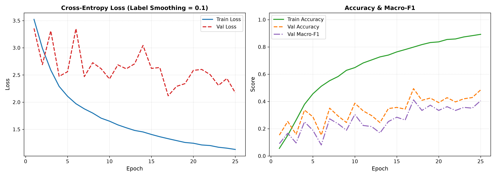

# Baseline Model Architecture: Simple Convolutional Neural Network

## 1. Overview and Design Objectives

The baseline architecture adheres strictly to a classical, non-residual feed-forward convolutional paradigm. It relies exclusively on standard convolutional, batch normalization, non-linear activation, spatial subsampling, global pooling, and dense classification layers.

The objective of this design is to establish a rigorous, transparent reference benchmark on the ASL Fingerspelling dataset (36 alphanumeric classes) under signer-independent evaluation conditions before introducing residual pathways or transfer learning backbones.

---

## 2. Detailed Layer Specifications and Tensor Geometry

The feature extraction hierarchy consists of four sequential downsampling stages followed by global spatial aggregation and a regularized multi-layer perceptron (MLP) classification head.

| Stage / Layer | Component Type | Kernel / Stride / Padding | Input Dimensions | Output Dimensions | Trainable Parameters |
| :--- | :--- | :--- | :--- | :--- | :--- |
| **Input** | RGB Tensor | — | — | $3 \times 224 \times 224$ | 0 |
| **Stage 1: Conv** | `Conv2d` | $3 \times 3$, $s=1$, $p=1$ | $3 \times 224 \times 224$ | $32 \times 224 \times 224$ | 864 |
| **Stage 1: Norm/Act** | `BatchNorm2d` + `ReLU` | — | $32 \times 224 \times 224$ | $32 \times 224 \times 224$ | 64 |
| **Stage 1: Pool** | `MaxPool2d` | $2 \times 2$, $s=2$ | $32 \times 224 \times 224$ | $32 \times 112 \times 112$ | 0 |
| **Stage 2: Conv** | `Conv2d` | $3 \times 3$, $s=1$, $p=1$ | $32 \times 112 \times 112$ | $64 \times 112 \times 112$ | 18,432 |
| **Stage 2: Norm/Act** | `BatchNorm2d` + `ReLU` | — | $64 \times 112 \times 112$ | $64 \times 112 \times 112$ | 128 |
| **Stage 2: Pool** | `MaxPool2d` | $2 \times 2$, $s=2$ | $64 \times 112 \times 112$ | $64 \times 56 \times 56$ | 0 |
| **Stage 3: Conv** | `Conv2d` | $3 \times 3$, $s=1$, $p=1$ | $64 \times 56 \times 56$ | $128 \times 56 \times 56$ | 73,728 |
| **Stage 3: Norm/Act** | `BatchNorm2d` + `ReLU` | — | $128 \times 56 \times 56$ | $128 \times 56 \times 56$ | 256 |
| **Stage 3: Pool** | `MaxPool2d` | $2 \times 2$, $s=2$ | $128 \times 56 \times 56$ | $128 \times 28 \times 28$ | 0 |
| **Stage 4: Conv** | `Conv2d` | $3 \times 3$, $s=1$, $p=1$ | $128 \times 28 \times 28$ | $256 \times 28 \times 28$ | 294,912 |
| **Stage 4: Norm/Act** | `BatchNorm2d` + `ReLU` | — | $256 \times 28 \times 28$ | $256 \times 28 \times 28$ | 512 |
| **Stage 4: Pool** | `MaxPool2d` | $2 \times 2$, $s=2$ | $256 \times 28 \times 28$ | $256 \times 14 \times 14$ | 0 |
| **Global Pooling** | `AdaptiveAvgPool2d` | target $(1 \times 1)$ | $256 \times 14 \times 14$ | $256 \times 1 \times 1$ | 0 |
| **Head: Flatten** | `Flatten` | — | $256 \times 1 \times 1$ | 256 | 0 |
| **Head: Reg 1** | `Dropout` ($p=0.4$) | — | 256 | 256 | 0 |
| **Head: Dense 1** | `Linear` + `ReLU` | — | 256 | 256 | 65,792 |
| **Head: Reg 2** | `Dropout` ($p=0.4$) | — | 256 | 256 | 0 |
| **Head: Output** | `Linear` | — | 256 | 36 | 9,252 |

- **Feature Extractor Parameters**: 388,896
- **Classification Head Parameters**: 75,044
- **Total Trainable Parameters**: **463,940** (compact budget under 500k parameters).

---

## 3. Theoretical Receptive Field Propagation

The effective receptive field ($RF$) evolves sequentially through convolutional and pooling layers according to:
$$RF_{l} = RF_{l-1} + (k_l - 1) \cdot j_{l-1}$$
where $j_l = j_{l-1} \cdot s_l$ represents the cumulative stride jump.

1. **Input**: $RF_0 = 1$, $j_0 = 1$.
2. **Stage 1**:
   - `Conv2d` ($k=3, s=1$): $RF_1 = 1 + (3 - 1) \cdot 1 = 3$, $j_1 = 1$.
   - `MaxPool2d` ($k=2, s=2$): $RF_2 = 3 + (2 - 1) \cdot 1 = 4$, $j_2 = 2$.
3. **Stage 2**:
   - `Conv2d` ($k=3, s=1$): $RF_3 = 4 + (3 - 1) \cdot 2 = 8$, $j_3 = 2$.
   - `MaxPool2d` ($k=2, s=2$): $RF_4 = 8 + (2 - 1) \cdot 2 = 10$, $j_4 = 4$.
4. **Stage 3**:
   - `Conv2d` ($k=3, s=1$): $RF_5 = 10 + (3 - 1) \cdot 4 = 18$, $j_5 = 4$.
   - `MaxPool2d` ($k=2, s=2$): $RF_6 = 18 + (2 - 1) \cdot 4 = 22$, $j_6 = 8$.
5. **Stage 4**:
   - `Conv2d` ($k=3, s=1$): $RF_7 = 22 + (3 - 1) \cdot 8 = 38$, $j_7 = 8$.
   - `MaxPool2d` ($k=2, s=2$): $RF_8 = 38 + (2 - 1) \cdot 8 = 46$, $j_8 = 16$.
6. **Global Aggregation**:
   - `AdaptiveAvgPool2d((1, 1))` collapses the final $14 \times 14$ spatial grid into a single descriptor, conferring full global receptive field coverage across the entire $224 \times 224$ letterboxed hand crop.

---

## 4. Optimization Protocol and Hyperparameters

Training is governed by an adaptive schedule with explicit early stopping to ensure convergence without over-constraining the model:

- **Partition Scheme**: Subject-Independent Split (Signers 1–7 for Training, Signer 8 for Validation, Signers 9–10 for Unseen Test).
- **Batch Size**: 64 samples per step.
- **Base Learning Rate**: $5.0 \times 10^{-4}$.
- **Optimizer**: AdamW with decoupled weight decay ($5.0 \times 10^{-4}$, `foreach=False` for DirectML compliance).
- **Loss Function**: Label Smoothing Cross-Entropy with smoothing factor $\alpha = 0.1$.
- **Learning Rate Schedule**: Sequential scheduler consisting of 2-epoch linear warmup followed by Cosine Annealing decay down to $\eta_{min} = 1.0 \times 10^{-6}$.
- **Regularization Pipeline**:
  - `RandomAffine`: Rotation $\pm 12^\circ$, translation $\pm 6\%$, scale range $[0.75, 1.35]$, padded with neutral gray `(128, 128, 128)`.
  - `KeepPadJitter`: Color jitter (brightness, contrast, saturation = 0.25) preserving background padding neutrality.
  - `RandomHorizontalFlip`: Stochastic horizontal reflection ($p = 0.5$) for ambidextrous generalization.
  - Classifier dropout rate: 0.4.
- **Early Stopping**: Monitored validation Macro-F1 with patience of 8 epochs.
- **Convergence Epoch**: The run reached peak validation performance at **Epoch 17** (Val F1: 0.4115, Val Accuracy: 49.40%) and early stopped after Epoch 25 without further improvement.

---

## 5. Empirical Performance on Unseen Test Set

The model checkpoint from the best validation epoch (`weights/best_model_1_simple_cnn.pt`) was evaluated on the completely unseen subject test set (7,200 images across signers 9 and 10).

| Metric | Measured Value | Percentage / Note |
| :--- | :--- | :--- |
| **Top-1 Accuracy** | **0.5271** | **52.71%** |
| **Macro Precision** | **0.5447** | **54.47%** |
| **Macro Recall** | **0.5271** | **52.71%** |
| **Macro F1-Score** | **0.4920** | **49.20%** |
| **Evaluation Loss** | **1.9444** | Cross-Entropy ($\alpha = 0.1$) |
| **Sample Throughput** | ~360 img/sec | DirectML execution on AMD Radeon RX 6700 XT |

### Class-Specific Analysis Highlights
- **High-performing signs ($F_1 = 1.000$)**: Digit `0` (two-handed posture), Digit `5` (open palm), Letter `C` ($F_1 = 0.985$), Letter `O` ($F_1 = 0.908$). These signs possess distinct geometric envelopes that remain robust across different signers' hand morphologies.
- **Confused signs**:
  - Digit `3` vs. Letter `W`: Visual overlap in extended three-finger configurations.
  - Letter `M` vs. Letter `N` vs. Letter `S`: Subtle thumb position variations tucked beneath differing fingers.
  - Digit `6` vs. Digit `9`: Circular finger touch configurations that differ primarily in fine distal joints.

---

## 6. Training Diagnostics and Visualizations

### Loss and Accuracy Curves
The convergence curves illustrate steady learning across the 25 epochs. While training accuracy surpassed 89%, validation accuracy leveled off near 49.40%, showing the typical generalization gap of shallow sequential architectures under cross-signer domain shift.

### Test Confusion Matrix
The 36-class confusion matrix on unseen signers 9 and 10 displays strong diagonal dominance across open and distinct signs, alongside clear off-diagonal clusters corresponding to fine-grained finger-tuck ambiguity.

