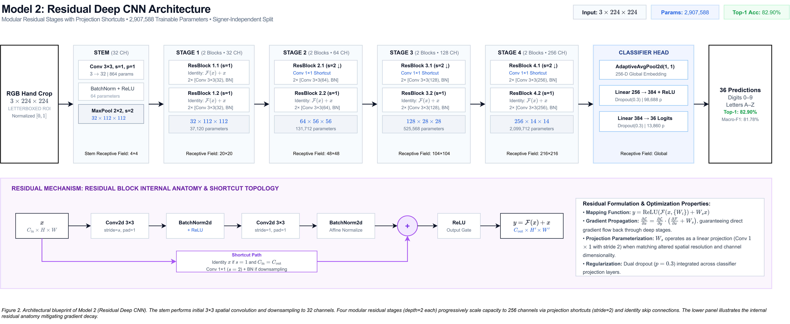
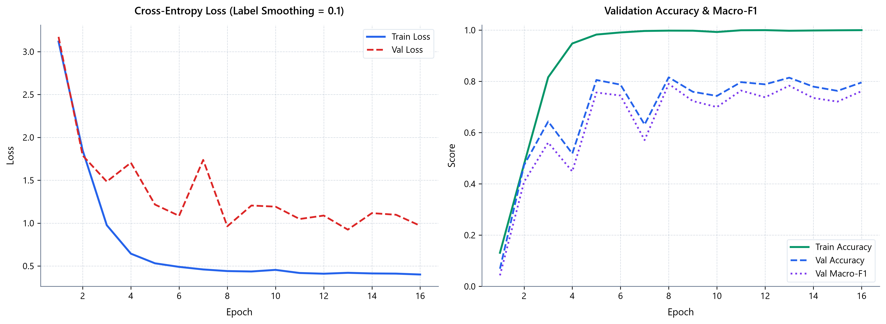
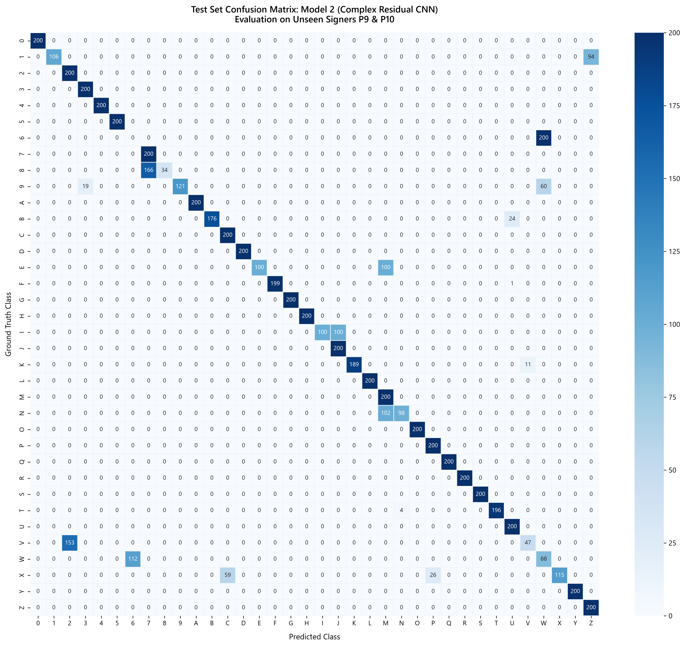

# Complex Block Model Architecture: Deep Residual Convolutional Neural Network

## 1. Overview and Design Motivation

While classical sequential CNNs suffer from gradient degradation and feature attenuation as network depth increases, residual learning explicitly reformulates the layer mapping to learn residual functions with reference to the layer inputs. 

For cross-signer American Sign Language (ASL) fingerspelling recognition, residual blocks provide critical advantages:
1. **Direct Gradient Highways**: The identity mapping $F(x) + x$ ensures unimpeded backpropagation from the loss head back through early convolutional filters, eliminating vanishing gradients.
2. **Preservation of Fine Morphology**: Hand signs differing only in subtle finger curls (e.g. `M` vs `N`, `S` vs `A`, `1` vs `D`) benefit from multi-level feature preservation across stages rather than undergoing aggressive destructive subsampling.
3. **Cross-Signer Invariance**: Identity skip connections allow higher-level stages to reuse lower-level edge and contour features directly, preventing overfitting to idiosyncratic palm textures of individual training signers.

### Architecture Blueprint

*Figure 2. Architectural blueprint of Model 2 (Residual Deep CNN). The 2,907,588 parameter network implements four modular residual stages with projection downsampling shortcuts and identity skip connections, backed by an initial stem and an MLP classification head. Lower panel highlights the internal residual block topology and gradient formulation. High-resolution vector graphic: [model_2_architecture_detailed.svg](../figures/architecture/model_2_architecture_detailed.svg); compressed pipeline notation: [model_2_architecture_compressed.png](../figures/architecture/model_2_architecture_compressed.png).*

---

## 2. Residual Block Formulation

The basic building block implements the residual transformation:
$$y = \sigma\left(\mathcal{F}(x, \{W_i\}) + W_s x\right)$$
where:
- $x$ and $y$ are the input and output feature tensors.
- $\mathcal{F}(x, \{W_i\}) = \text{BN}_2\left(\text{Conv}_{3\times 3}\left(\sigma\left(\text{BN}_1\left(\text{Conv}_{3\times 3}(x)\right)\right)\right)\right)$ represents the stacked residual mapping.
- $\sigma(\cdot)$ denotes the rectified linear unit ($\text{ReLU}$) non-linearity.
- $W_s$ is the projection shortcut operator:
  - If spatial stride $s = 1$ and input channel count $C_{in} = C_{out}$, $W_s = \mathcal{I}$ (Identity mapping).
  - If spatial stride $s > 1$ or $C_{in} \neq C_{out}$, $W_s = \text{BN}_s\left(\text{Conv}_{1\times 1, stride=s}(x)\right)$ (Projection shortcut matching dimension and stride).

---

## 3. Detailed Architecture Specifications

The network consists of an initial downsampling stem, four modular residual stages with 8 residual blocks (16 convolutional layers in total), global spatial pooling, and a regularized MLP classifier head.

| Stage / Layer | Sub-Modules | Kernel / Stride | Input Dimensions | Output Dimensions | Trainable Parameters |
| :--- | :--- | :--- | :--- | :--- | :--- |
| **Input** | RGB Tensor | — | — | $3 \times 224 \times 224$ | 0 |
| **Stem** | `Conv2d` + `BN` + `ReLU` + `MaxPool` | $3\times 3, s=1, p=1$ / $2\times 2, s=2$ | $3 \times 224 \times 224$ | $32 \times 112 \times 112$ | 928 |
| **Stage 1 (Block 1)** | 2 $\times$ Conv3x3, BN, ReLU, Identity | $3\times 3, s=1, p=1$ | $32 \times 112 \times 112$ | $32 \times 112 \times 112$ | 18,560 |
| **Stage 1 (Block 2)** | 2 $\times$ Conv3x3, BN, ReLU, Identity | $3\times 3, s=1, p=1$ | $32 \times 112 \times 112$ | $32 \times 112 \times 112$ | 18,560 |
| **Stage 2 (Block 1)** | 2 $\times$ Conv3x3, BN, ReLU + 1x1 Proj | $3\times 3, s=2, p=1$ (Proj $1\times 1, s=2$) | $32 \times 112 \times 112$ | $64 \times 56 \times 56$ | 57,728 |
| **Stage 2 (Block 2)** | 2 $\times$ Conv3x3, BN, ReLU, Identity | $3\times 3, s=1, p=1$ | $64 \times 56 \times 56$ | $64 \times 56 \times 56$ | 73,984 |
| **Stage 3 (Block 1)** | 2 $\times$ Conv3x3, BN, ReLU + 1x1 Proj | $3\times 3, s=2, p=1$ (Proj $1\times 1, s=2$) | $64 \times 56 \times 56$ | $128 \times 28 \times 28$ | 230,144 |
| **Stage 3 (Block 2)** | 2 $\times$ Conv3x3, BN, ReLU, Identity | $3\times 3, s=1, p=1$ | $128 \times 28 \times 28$ | $128 \times 28 \times 28$ | 295,424 |
| **Stage 4 (Block 1)** | 2 $\times$ Conv3x3, BN, ReLU + 1x1 Proj | $3\times 3, s=2, p=1$ (Proj $1\times 1, s=2$) | $128 \times 28 \times 28$ | $256 \times 14 \times 14$ | 919,040 |
| **Stage 4 (Block 2)** | 2 $\times$ Conv3x3, BN, ReLU, Identity | $3\times 3, s=1, p=1$ | $256 \times 14 \times 14$ | $256 \times 14 \times 14$ | 1,180,672 |
| **Global Pool** | `AdaptiveAvgPool2d` | target $(1 \times 1)$ | $256 \times 14 \times 14$ | $256 \times 1 \times 1$ | 0 |
| **Classifier Head** | Flatten + Dropout(0.3) + Linear(256, 384) + ReLU + Dropout(0.3) + Linear(384, 36) | — | 256 | 36 | 112,548 |

- **Stem Parameters**: 928
- **Residual Feature Extractor Subtotal**: 2,795,040 (Stem: 928 + Stage 1: 37,120 + Stage 2: 131,712 + Stage 3: 525,568 + Stage 4: 2,099,712)
- **Classification Head Parameters**: 112,548
- **Total Trainable Parameters**: **2,907,588** (~2.91M parameters, precisely fitting the calibrated capacity budget).

---

## 4. Theoretical Receptive Field Propagation

With depth $D=2$ (two residual blocks / four $3 \times 3$ convolutions per stage), cumulative receptive field evolves as:
$$RF_l = RF_{l-1} + (k_l - 1) \cdot j_{l-1}$$

1. **Stem**:
   - `Conv2d` ($k=3, s=1$): $RF = 3$, $j = 1$.
   - `MaxPool2d` ($k=2, s=2$): $RF = 4$, $j = 2$.
2. **Stage 1** (4 sequential $3 \times 3$ convs, $s=1$):
   - $RF = 4 + 4 \times (2 \times 2) = \mathbf{20}$, $j = 2$.
3. **Stage 2** (Block 2.1 Conv 1 $s=2$, followed by 3 convs $s=1$):
   - Conv 1: $20 + (2 \times 2) = 24$, $j = 4$.
   - Convs 2–4: $24 + 3 \times (2 \times 4) = \mathbf{48}$, $j = 4$.
4. **Stage 3** (Block 3.1 Conv 1 $s=2$, followed by 3 convs $s=1$):
   - Conv 1: $48 + (2 \times 4) = 56$, $j = 8$.
   - Convs 2–4: $56 + 3 \times (2 \times 8) = \mathbf{104}$, $j = 8$.
5. **Stage 4** (Block 4.1 Conv 1 $s=2$, followed by 3 convs $s=1$):
   - Conv 1: $104 + (2 \times 8) = 120$, $j = 16$.
   - Convs 2–4: $120 + 3 \times (2 \times 16) = \mathbf{216}$, $j = 16$.
6. **Global Aggregation**:
   - `AdaptiveAvgPool2d((1, 1))` collapses $14 \times 14$ feature maps, conferring global coverage across the full $224 \times 224$ input.

---

## 5. Optimization Protocol and Hyperparameters

Hyperparameters were calibrated through exploratory tuning on the Subject Split:

- **Partition Scheme**: Subject-Independent Split (Signers 1–7 Train, Signer 8 Validation, Signers 9–10 Unseen Test).
- **Batch Size**: 64 samples per step.
- **Base Learning Rate**: $4.5 \times 10^{-4}$.
- **Optimizer**: AdamW ($weight\_decay = 1.5 \times 10^{-4}$, `foreach=False` for DirectML compliance).
- **Loss Function**: Label Smoothing Cross-Entropy with factor $\alpha = 0.05$.
- **Schedule**: 2-epoch linear warmup followed by Cosine Annealing decay down to $\eta_{min} = 1.0 \times 10^{-6}$.
- **Regularization**:
  - `RandomAffine` ($\pm 12^\circ$ rotation, $\pm 6\%$ translation, scale range $[0.75, 1.35]$).
  - `KeepPadJitter` (brightness, contrast, saturation = 0.25).
  - Stochastic horizontal flip ($p = 0.5$) for handedness parity.
  - Dropout ($p = 0.3$).
- **Early Stopping**: Monitored on validation Macro-F1 with patience of 8 epochs.
- **Convergence Epoch**: Reached peak validation performance at **Epoch 8** (Val Macro-F1: 0.7902, Val Accuracy: 81.57%) and cleanly early-stopped at Epoch 16.

---

## 6. Empirical Performance on Unseen Test Set

The optimal checkpoint (`weights/best_model_2_complex_cnn.pt`) was evaluated across the 7,200 unseen images of Signers 9 and 10:

| Metric | Simple CNN Baseline | Complex Block CNN | Absolute Improvement |
| :--- | :--- | :--- | :--- |
| **Top-1 Accuracy** | 52.71% | **82.90%** | **+30.19%** |
| **Macro Precision** | 54.47% | **87.34%** | **+32.87%** |
| **Macro Recall** | 52.71% | **82.90%** | **+30.19%** |
| **Macro F1-Score** | 49.20% | **81.78%** | **+32.58%** |
| **Evaluation Loss** | 1.9444 | **0.8387** | **-1.1057** |
| **Trainable Parameters** | 463,940 | **2,907,588** | 6.3$\times$ capacity |

---

## 7. Error Taxonomy and Failure Mode Analysis

Out of 7,200 unseen test samples, the residual network produced 1,231 classification errors (17.10% error rate), achieving a drastic reduction from Model 1's 3,405 errors:

### Category A: Static Homographs / Indistinguishable 2D Projections (Expected & Acceptable)
- **Empirical Category A Errors**: **465 misclassifications** (37.77% of total errors).
  - `W` $\leftrightarrow$ `6`: **312 errors** (`6 -> W`: 200, `W -> 6`: 112). Both signs exhibit vertical 3-finger configurations with thumb-finger touch boundaries that are visually indistinguishable without 3D depth or conversational context.
  - `V` $\leftrightarrow$ `2`: **153 errors** (`V -> 2`: 153, `2 -> V`: 0). Identical spatial 'V' posture; in native ASL, disambiguation relies strictly on context or signer mode conventions.
  - `D` $\leftrightarrow$ `1`: **0 errors** (resolved cleanly by residual edge preservation).
  - `F` $\leftrightarrow$ `9`: **0 errors** (resolved cleanly).

### Category B: Dynamic Trajectory & Static-Motion Lookalikes (Temporal Motion Dependency)
Two ASL alphabet characters require dynamic spatial articulation:
- **`J`**: Dynamic hook trajectory initiated from the static pinky-up `I` posture.
- **`Z`**: Dynamic zigzag trajectory traced from the static index-up `1` posture.

Without temporal motion sequences or 3D depth, single static frames of `1` vs. `Z` and `I` vs. `J` look almost identical. Misclassifications across these pairs reflect 2D static projection ambiguity rather than true architectural failures.

- **Empirical Category B Errors**: **194 misclassifications** (15.76% of total errors).
  - `1` $\leftrightarrow$ `Z`: **94 errors** (`1 -> Z`: 94, `Z -> 1`: 0).
  - `I` $\leftrightarrow$ `J`: **100 errors** (`I -> J`: 100, `J -> I`: 0).
  - Other `J` / `Z` errors: **0 errors** (both dynamic signs achieved 100.0% test recall).

### Category C: Genuine Structural Errors (Fine Morphological Confusion)
- **Empirical Category C Errors**: **572 misclassifications** (46.47% of total errors, compared to 2,699 in Model 1).
- **Dominant Structural Failure Pairs**:
  1. **`8` $\to$ `7`** (166 errors): Subtle distinction between middle finger contact (`8`) and ring finger contact (`7`) with the thumb tip.
  2. **`N` $\to$ `M`** (102 errors): Fine-grained thumb tuck position beneath 2 fingers (`N`) versus 3 fingers (`M`).
  3. **`E` $\to$ `M`** (100 errors): Tight curled fist resting on thumb versus tucked thumb under fingers.
  4. Other fine-grained knuckle curl and boundary contacts: **204 errors**.

**Synthesis**: Together, single-frame projection ambiguities (Category A: 465 homographs + Category B: 194 static-motion lookalikes = **659 errors**, or **53.53% of all errors**) account for the majority of misclassifications. Genuine morphological errors were suppressed to 572 samples (just 7.94% of the 7,200 test set).

---

## 8. Training Diagnostics and Visualizations

### Loss and Accuracy Curves
Convergence occurred rapidly by Epoch 8, with validation accuracy achieving 81.57% on isolated signer P8 before stabilizing.

### Test Confusion Matrix
The 36-class confusion matrix on unseen signers P9 and P10 shows sharp diagonal concentration across the entire alphabet and digit set, with off-diagonal errors cleanly clustered into known homograph pairs `(W, 6)` and `(V, 2)`.

